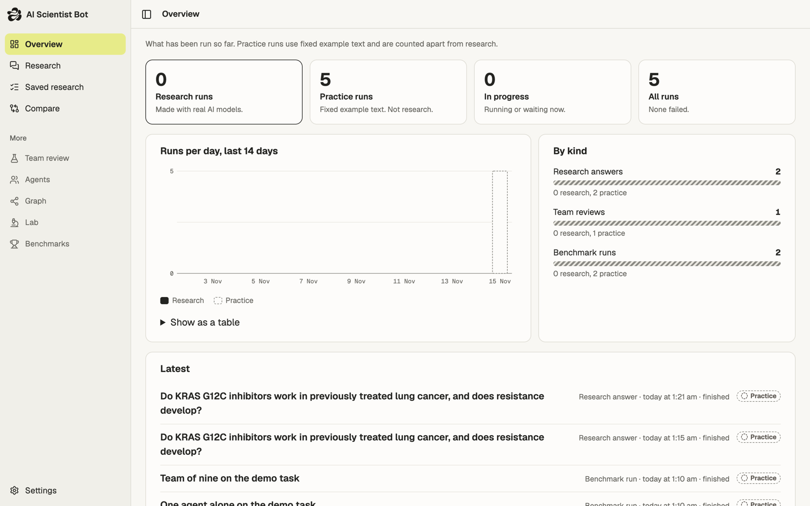
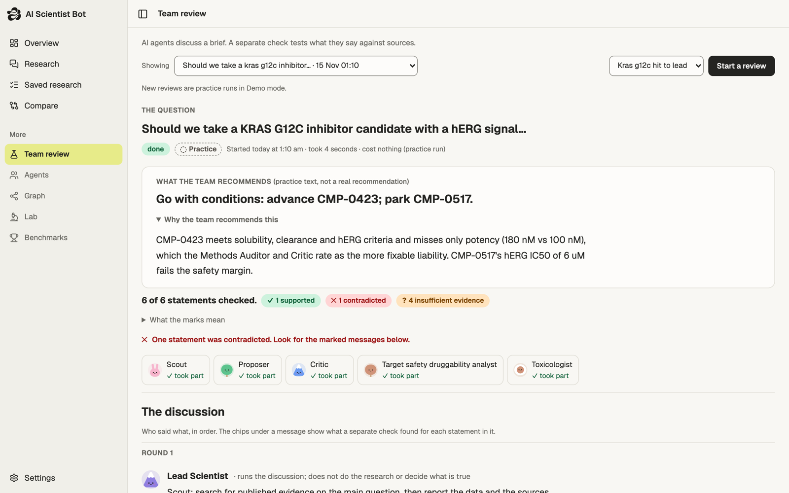
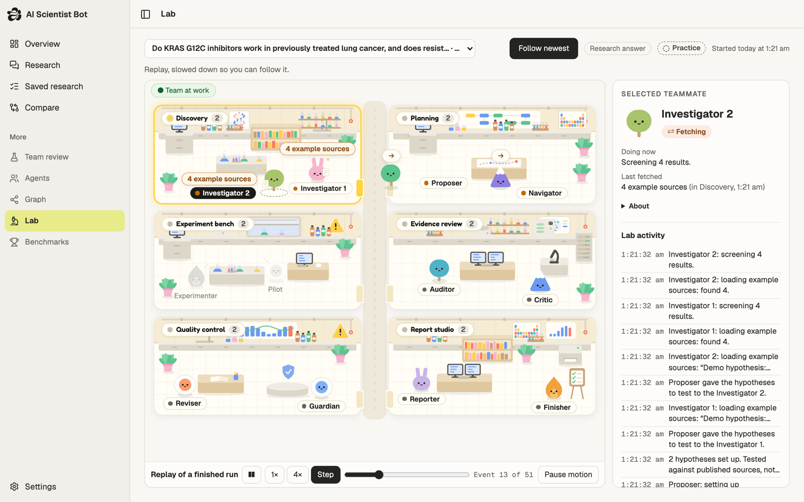
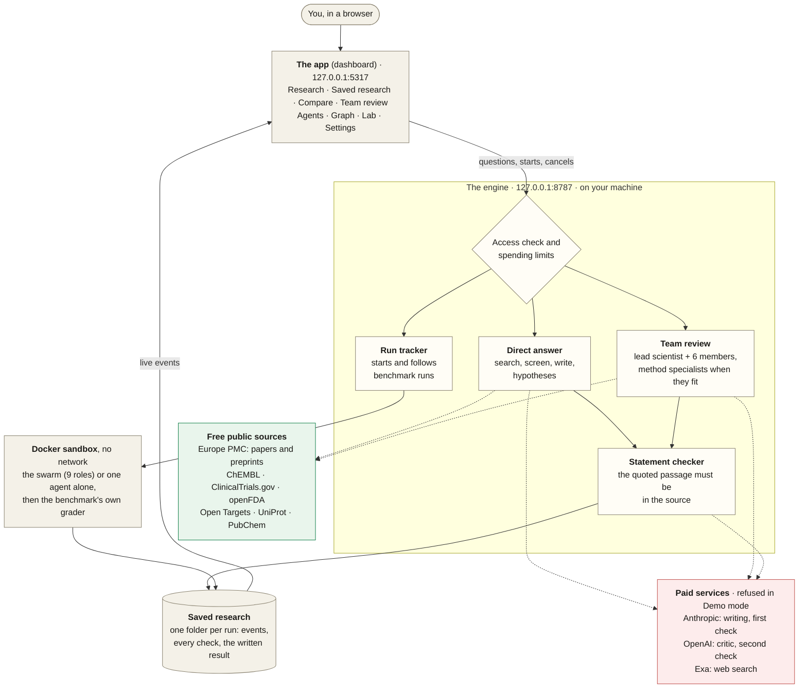

# AI Scientist Bot

**Ask a science question. A team of AI agents researches it. You see what they found, what they
checked, and what is still uncertain.**

Built for the **SF AI Research Hackathon** (Track 3, AI Scientist Swarms) by team GLHF:
Brendan Dang, Anh Lam and Josh Bustamante.

## Why we built it

An AI model can write a confident answer that is wrong. This app does not ask you to trust the
answer. It shows the work:

1. **You ask.** For example: "Should we take this drug candidate forward?"
2. **Agents work on it.** One searches for sources, one plans, one looks for mistakes, one writes.
3. **Statements are checked against their sources.** A second AI model, from a different company,
   must find the exact passage that backs a statement. Each checked statement gets a mark:
   supported, contradicted, or not enough evidence.
4. **You read the result with the marks.** You can open any statement and see who said it, which
   source it cites, and how it was checked.

The app is allowed to say "I do not know" or "nothing was found". That is better than a guess.

## The brief: Track 3, AI Scientist Swarms

The hackathon's instructions for the track we entered, as given:

> **The question:** can a team of agents reproduce a full computational biology study from raw
> data better than the best single frontier model?
>
> **What to build:** generating hypotheses is the easy part, rejecting the wrong ones is harder.
> Build a multi-agent system where agents with different roles (proposer, experimenter, critic)
> plan, run the analysis and check each other's results before anything is reported.
>
> **Record to beat:** BixBench3 (Edison Scientific), 20 published studies rebuilt from raw data.
> Best score: 0.523.
>
> **Context:** Kosmos (Edison Scientific, 2025) coordinates 200+ agents through a shared world
> model, and independent scientists judged 79.4% of its statements accurate, so about 1 in 5 is
> wrong. Popper (Huang et al., ICML 2025) has agents design falsification experiments with
> Type-I error control.
>
> **Judged on:** score vs. the record and a single-agent baseline on the same compute budget,
> rigour, reproducibility. Report what the swarm rejected as well as what it found.

## Try it

You need a terminal and [Node.js](https://nodejs.org) 24 or newer.

```bash
git clone https://github.com/itsbrendandang/agent-test.git && cd agent-test
npm run setup    # once, after cloning
npm start        # starts everything and opens http://127.0.0.1:5317 in your browser
```

Press Ctrl+C to stop. After every `git pull`, stop and run `npm start` again.

A new copy starts in **Demo mode**. Demo mode is free and needs no account. Its answers are fixed
examples that show how the app works. They are not research.

## Demo and Real

| | Demo | Real |
|---|---|---|
| Answers | Fixed example text | Written by real AI models |
| Sources | Example sources | Real web and literature searches |
| Cost | Free | Costs money, with limits you see before you start |
| Keys needed | None | Your own keys (below) |

To use Real mode:

```bash
cp .env.example .env    # open .env and paste your own keys after the = signs
npm run preflight       # free: checks your keys and prints the spending limits
```

You need an `ANTHROPIC_API_KEY`, an `OPENAI_API_KEY` and an `EXA_API_KEY`. Then start the app and
switch from Demo to Real in **Settings**. The app shows the limits and asks you to confirm before
anything is spent.

- Keys are never stored in this repository. Each person uses their own. Do not share them or
  paste them in a chat.
- A key alone spends nothing. Real mode is off until the person who pays turns it on.
- Each run has a spending limit, and each day has one too. A run is stopped at its limit (it can
  pass it by a few cents, because the check happens between steps).

## What is in the app

| Screen | What it is for |
|---|---|
| Overview | The first screen: how much has been run, how much of it is research, and a chart per day. |
| Research | The chat. Ask a question and read the answer with its sources and its hypotheses. |
| Saved research | Everything that was run before. You can search it and open any result. |
| Compare | A team of nine agents against one agent alone, on the same task. |
| Team review | One review in detail: what each agent said, and how each statement was checked. |
| Agents | The agents and what each one does. |
| Graph | One run as a picture of who said what. |
| Lab | The agents as characters in a lab. They walk only when the engine reports real work. |
| Benchmarks | Our benchmark results set out as an evaluation: model, accuracy with its interval, tokens, time and cost, beside the record to beat. |
| Settings | Demo or Real, spending limits, how it works. |

The pictures below are from **Demo mode**. Every one shows a practice run: fixed example text,
not research. The app labels such runs "Practice" itself.

**Overview.** Practice runs are counted apart from research, so the big number is only what real
models produced.



**Research.** You ask; the answer is split into hypotheses, each with the sources for and against
it.


**Team review.** The decision first, then how many statements were checked and how each one did.



**Lab.** The same run as a scene: who is working, who fetched what, and a log of every step.
The lab's look is by Anh Lam.



**Benchmarks.** These numbers are real runs, read from the run records. Where something was not
measured the screen says "Not known".


## Where things stand

We say only what was really done.

- **Works today:** the app, Demo mode, and a full practice review from question to written
  recommendation.
- **Tested with real AI models, in a small way:** a team of agents and one agent alone both worked
  on 8 benchmark questions. They scored the same (4 of 8), and the team cost more.
- **Not done yet:** a full benchmark run. So we cannot say that a team of agents is better than
  one agent. That is the question this project was built to test.
- **Done once:** a team review with real AI models from start to end. It made 3 web searches
  (Exa) and 5 literature searches, and checked 204 statements: 71 supported, 28 without enough
  evidence, 105 not checked (75 of those are calculations, which the checker cannot re-run), none
  contradicted. It cost $1.31 and took 8 minutes. One run is not evidence that the reviews are
  good.
- **Built, and tested in Demo mode only:** the direct answer in the chat (numbered sources,
  visible steps, hypotheses with sources for and against), and the Lab. No real AI model has
  written a direct answer yet; a real one stays switched off until we turn it on.
- **Being built now:** open models and a sandbox on Modal, and a shared store for what the
  agents find. Today each run keeps its own folder of files; there is no database yet.
- **Memory between runs (past.dev):** wired into the nine-agent swarm only, and a person must
  approve each lesson before it is saved. It has not been used in a full real run. The team
  review and the chat do not use it.

The exact list, with what was tested and how, is in [docs/status.md](docs/status.md).

## Benchmarks

A first report, in words. Charts and a fuller scope come later.

**Two benchmarks, and they are not the same thing.**

| | BixBench3 | BixBench v1.5 |
|---|---|---|
| Who made it | Edison Scientific | FutureHouse (public dataset `futurehouse/BixBench`) |
| The task | Rebuild a published study from raw data: 20 studies | Answer questions about a dataset: 205 questions on 59 datasets |
| Record | 0.523, the number Track 3 asks us to beat | Published numbers exist, but ours cannot be set beside them yet (see below) |
| Our solver | Nine-role swarm, in `glhf/bixbench/` | Three-role swarm (analyst, blind critic, reconciler), in `glhf/bixbench_v1/` |
| Compared with | One agent alone, same model | One agent alone, same model, same token budget by default |

**What we have run with real AI models.**

| Benchmark | What was run | Result |
|---|---|---|
| BixBench3 | No real task yet. | No score. We cannot compare with 0.523. |
| BixBench v1.5 | A pilot: 3 datasets, 8 questions, `anthropic/claude-sonnet-5-5`. | One agent: 4 of 8 correct, 317,110 tokens. Swarm: 4 of 8 correct, 532,394 tokens (about 1.7 times). |
| BixBench v1.5 | 20 datasets, 82 questions, an open model (Qwen3.6 35B) served on Modal, same token limit for both. | One agent: 15 of 82. Swarm: 19 of 82. No difference detected (exact p = 0.29). 42 of the 82 answers were not graded, because no judge model was used; they count as wrong, so both scores are lower bounds. |

The Benchmarks screen in the app shows these rows with their intervals, tokens and time.

Eight questions are far too few to tell the two apart. The pilot also used an older swarm; it
has changed since, and the changes were tested with a scripted model only, not a real one. We
also ran a small practice case of our own with both solvers. That checks that the system works;
it is not a benchmark result.

**How a comparison is kept fair.** This follows what Track 3 is judged on.

- **Same compute budget.** By default the swarm gets the same token total as the single agent.
  A run where the swarm got more is labelled "more budget" and reported apart.
- **Same rules for both.** Same model, sandbox, tools, instructions and time limit. Both get
  the same last turn to record answers when the budget ends.
- **No answers in reach.** The answer key never enters the sandbox or the prompt. Only data
  files are copied in; solution notebooks and write-ups are left out.
- **What was rejected is reported.** Each swarm run lists the answers it threw out and why,
  next to the answers it kept.
- **Honest statistics.** Each report says how it was graded and whether its numbers can be
  compared with published ones. Today the answer is "no", with the reasons: for example, our
  sandbox has no network and the official one does. Questions that share a dataset are not
  counted as independent evidence.
- **Reproducible.** Every run records its settings, seed, sandbox image and token use.

**What comes next.** A full run of both solvers on one benchmark at the same budget, then
charts of score, cost and what the swarm rejected. Until then we do not claim that a team of
agents beats one agent.

Details: [docs/status.md](docs/status.md), [glhf/bixbench_v1/README.md](glhf/bixbench_v1/README.md),
[docs/reading-results.md](docs/reading-results.md).

## Sponsor tools

What we were given, and what this project really uses. "Called" means a real request was sent.

| Tool | What we use it for | Really called so far? |
|---|---|---|
| [Exa](https://exa.ai) | Web search. The scout agent opens a review with it. The benchmark agents can search tool documentation with it. | Yes. One real team review made 3 searches and checked statements against the pages found. Before that, three searches by hand. |
| [past.dev](https://past.dev) | Long-term memory for the benchmark agents: lessons a person approved are saved and recalled. | Yes, saving and recalling were tested by hand. No full run has used it yet. |
| OpenAI | The second checker and the critic agent (a different company from the main model, on purpose). The judge that grades benchmark answers. | Yes. It made 12 second checks in the one real team review, and `gpt-4o` graded the 8 pilot questions. A teammate's separate baseline also used it. |
| [Modal](https://modal.com) | Cloud computers: to run open models next to Claude and OpenAI models on the benchmark, and to host the app. | Partly. The app is hosted there in Demo mode behind a sign-in (no keys, practice runs only; see below). The weights of one open model were downloaded and a test sandbox was set up. No open model has been served for a benchmark run yet. |
| Tinker (Thinking Machines) | Not used. | No. No code calls it. |
| Devin (Cognition) | Not used. | No. |

The main AI models are Claude models from Anthropic (not a sponsor credit). They were called for
the 8 pilot questions and for one chat question.

**Hosted on Modal (Demo mode).** The app also runs as one private web address on Modal:
`deploy/modal_host/`. The owner gives each teammate a personal access code; nothing is served
without sign-in. The hosted engine has no API key: it does practice reviews and demo answers only,
and says so. Runs are kept on a Modal Volume and survive a container stop; a review that was cut
off continues at the next visit. Swarm and benchmark runs are not available there yet. The
container stops after five idle minutes and then costs nothing. Deploy, access codes, cost and
limits: [deploy/modal_host/README.md](deploy/modal_host/README.md). Real mode in the cloud is
designed, not deployed: [deploy/modal_host/REAL-MODE.md](deploy/modal_host/REAL-MODE.md).

## How it fits together

You use the app in a browser. The app only talks to the engine on your own machine. The engine
holds the keys, enforces the spending limits, and is the only part that reaches outside services.



Solid arrows stay on your machine. Dotted arrows leave it, and only the engine sends them: the
red box costs money and is refused in Demo mode; the green box is free. In a team review only one
member, the scout, searches. The swarm's sandbox has no network at all. A direct answer written
by real models is built but still switched off (see "Where things stand").

The engine is built on a durable agent harness ([Pi Durable](docs/pi-setup.md)). Every step is
saved as it happens. A review that is interrupted, for example by a crash or a restart, continues
where it stopped and does not repeat (or pay again for) finished work. We tested this by stopping
a practice review in the middle.

## Words

| Word | Plain meaning |
|---|---|
| Agent | One AI model given one job and its own instructions. |
| Team review | Agents discuss a written question in rounds, and a lead agent writes a recommendation. In the code it is called "board". |
| Swarm | A team of agents that works through a data-analysis task in a fixed order. |
| Single agent | One AI model doing the whole task alone. We compare the team against it. |
| Practice run | A run in Demo mode, with fixed example answers. Free. Not research. |
| Real run | A run that uses real AI models. It costs money. |
| Benchmark | A public set of tasks with known answers, used to measure a method. Ours is BixBench (biology data analysis). |
| Engine | The program on your machine that runs everything and guards the spending. |

## Check that your copy is healthy

```bash
npm run check    # about 3 minutes; never spends money
```

It prints one line per part, `ok` or `FAIL`. On `main` today all five parts print `ok`: no
merge-conflict markers, both type checks clean, 452 engine tests and 798 dashboard tests pass.
If a line says `FAIL` on your copy, run `npm run setup` again first. More about the tests is in
[docs/developers.md](docs/developers.md#tests).

## Read more

| If you want to | Read |
|---|---|
| Set up your machine and contribute | [CONTRIBUTING.md](CONTRIBUTING.md) |
| Understand the folders and where new code goes | [docs/codebase.md](docs/codebase.md) |
| See every command, the two parts of the project, the tests and the limits | [docs/developers.md](docs/developers.md) |
| Know exactly what was tested | [docs/status.md](docs/status.md) |
| Understand a team review and what "supported" means | [docs/drug-board.md](docs/drug-board.md) |
| Read results and compare fairly | [docs/reading-results.md](docs/reading-results.md) |
| Use a coding agent on this repository | [AGENTS.md](AGENTS.md) |

## Limits you should know

- "Supported" means a second AI model found a real passage in the source, with the same numbers.
  It does not prove the passage is right, or that the source is good.
- Searches return summaries and short excerpts, not full papers. A true statement can still end
  as "not enough evidence".
- This is a research aid. It does not replace an expert, and it is not medical advice.

## Licence

Our own code is under the MIT licence (`LICENSE`). Two folders are not: `glhf/bixbench/` is a
modified copy of BixBench3 (Edison Scientific, CC BY-SA 4.0; our changes are listed in
`glhf/bixbench/CHANGES.md` and carry the same licence), and `glhf/bixbench_v1/` depends on it and
is offered under CC BY-SA 4.0 as well. Third-party files keep their own terms.
