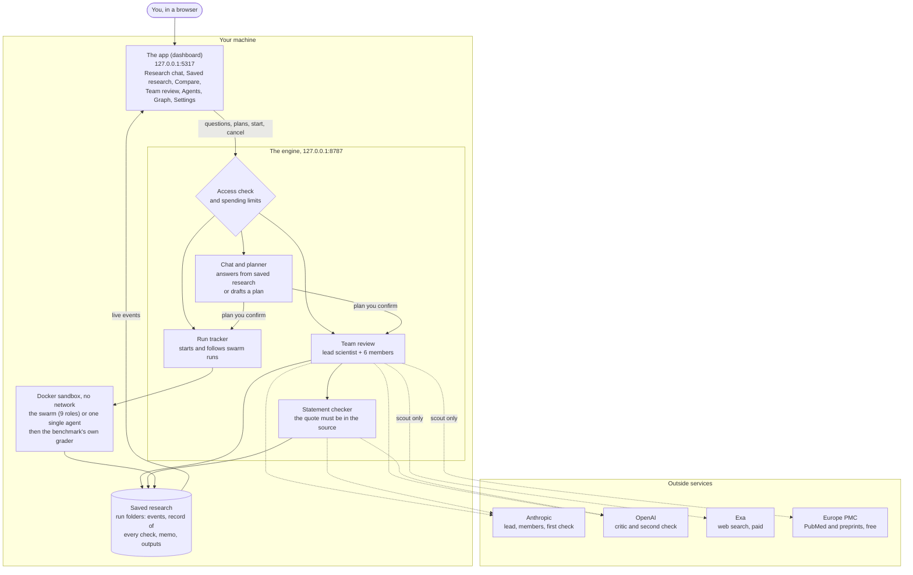

# AI Scientist Bot

**Ask a science question. A team of AI agents researches it. You see what they found, what they
checked, and what is still uncertain.**

Built for the **SF AI Research Hackathon** (Track 3, AI Scientist Swarms) by team GLHF:
Brendan Dang, Anh Lam and Josh Bustamante.

## Why we built it

An AI model can write a confident answer that is wrong. This app does not ask you to trust the
answer. It shows the work:

1. **You ask.** For example: "Should we take this drug candidate forward?"
2. **Agents work on it.** One searches for sources, one plans, one looks for mistakes, one writes.
3. **Statements are checked against their sources.** A second AI model, from a different company,
   must find the exact passage that backs a statement. Each checked statement gets a mark:
   supported, contradicted, or not enough evidence.
4. **You read the result with the marks.** You can open any statement and see who said it, which
   source it cites, and how it was checked.

The app is allowed to say "I do not know" or "nothing was found". That is better than a guess.

## Try it

You need a terminal and [Node.js](https://nodejs.org) 24 or newer.

```bash
git clone https://github.com/itsbrendandang/agent-test.git && cd agent-test
npm run setup    # once, after cloning
npm start        # starts everything and opens http://127.0.0.1:5317 in your browser
```

Press Ctrl+C to stop. After every `git pull`, stop and run `npm start` again.

A new copy starts in **Demo mode**. Demo mode is free and needs no account. Its answers are fixed
examples that show how the app works. They are not research.

## Demo and Real

| | Demo | Real |
|---|---|---|
| Answers | Fixed example text | Written by real AI models |
| Sources | Example sources | Real web and literature searches |
| Cost | Free | Costs money, with limits you see before you start |
| Keys needed | None | Your own keys (below) |

To use Real mode:

```bash
cp .env.example .env    # open .env and paste your own keys after the = signs
npm run preflight       # free: checks your keys and prints the spending limits
```

You need an `ANTHROPIC_API_KEY`, an `OPENAI_API_KEY` and an `EXA_API_KEY`. Then start the app and
switch from Demo to Real in **Settings**. The app shows the limits and asks you to confirm before
anything is spent.

- Keys are never stored in this repository. Each person uses their own. Do not share them or
  paste them in a chat.
- A key alone spends nothing. Real mode is off until the person who pays turns it on.
- Each run has a spending limit, and each day has one too. A run is stopped at its limit (it can
  pass it by a few cents, because the check happens between steps).

## What is in the app

| Screen | What it is for |
|---|---|
| Research | The chat. Ask a question here. |
| Saved research | Everything that was run before. You can search it and open any result. |
| Compare | A team of agents against one agent alone, on the same task. |
| Team review | One review in detail: what each agent said, and how each statement was checked. |
| Agents | The agents and what each one does. |
| Graph | One run as a picture of who said what. |
| Settings | Demo or Real, spending limits, how it works. |

We are reworking the screens this week, so a name on your screen may differ a little.

## Where things stand

We say only what was really done.

- **Works today:** the app, Demo mode, and a full practice review from question to written
  recommendation.
- **Tested with real AI models, in a small way:** a team of agents and one agent alone both worked
  on 8 benchmark questions. They scored the same (4 of 8), and the team cost more.
- **Not done yet:** a full benchmark run. So we cannot say that a team of agents is better than
  one agent. That is the question this project was built to test.
- **Done once:** a team review with real AI models from start to end. It made 3 web searches
  (Exa) and 5 literature searches, and checked 204 statements: 71 supported, 28 without enough
  evidence, 105 not checked (75 of those are calculations, which the checker cannot re-run), none
  contradicted. It cost $1.31 and took 8 minutes. One run is not evidence that the reviews are
  good.
- **Being built now:** a direct answer in the chat with numbered sources and visible steps, a
  simpler screen layout, an animated "lab" that shows the agents at work, and open models on
  Modal.

The exact list, with what was tested and how, is in [docs/status.md](docs/status.md).

## Sponsor tools

What we were given, and what this project really uses. "Called" means a real request was sent.

| Tool | What we use it for | Really called so far? |
|---|---|---|
| [Exa](https://exa.ai) | Web search. The scout agent opens a review with it. The benchmark agents can search tool documentation with it. | Yes. One real team review made 3 searches and checked statements against the pages found. Before that, three searches by hand. |
| [past.dev](https://past.dev) | Long-term memory for the benchmark agents: lessons a person approved are saved and recalled. | Yes, saving and recalling were tested by hand. No full run has used it yet. |
| OpenAI | The second checker and the critic agent (a different company from the main model, on purpose). The judge that grades benchmark answers. | Yes. It made 12 second checks in the one real team review, and `gpt-4o` graded the 8 pilot questions. A teammate's separate baseline also used it. |
| [Modal](https://modal.com) | Cloud computers: to run open models next to Claude and OpenAI models on the benchmark, and to host the app. | Partly. The app is hosted there in Demo mode behind a sign-in (no keys, practice runs only; see below). The weights of one open model were downloaded and a test sandbox was set up. No open model has been served for a benchmark run yet. |
| Tinker (Thinking Machines) | Not used. | No. No code calls it. |
| Devin (Cognition) | Not used. | No. |

The main AI models are Claude models from Anthropic (not a sponsor credit). They were called for
the 8 pilot questions and for one chat question.

**Hosted on Modal (Demo mode).** The app also runs as one private web address on Modal:
`deploy/modal_host/`. The owner gives each teammate a personal access code; nothing is served
without sign-in. The hosted engine has no API key: it does practice reviews and demo answers only,
and says so. Runs are kept on a Modal Volume and survive a container stop; a review that was cut
off continues at the next visit. Swarm and benchmark runs are not available there yet. The
container stops after five idle minutes and then costs nothing. Deploy, access codes, cost and
limits: [deploy/modal_host/README.md](deploy/modal_host/README.md). Real mode in the cloud is
designed, not deployed: [deploy/modal_host/REAL-MODE.md](deploy/modal_host/REAL-MODE.md).

## How it fits together

You use the app in a browser. The app only talks to the engine on your own machine. The engine
holds the keys, enforces the spending limits, and is the only part that reaches outside services.



The engine is built on a durable agent harness ([Pi Durable](docs/pi-setup.md)). Every step is
saved as it happens. A review that is interrupted, for example by a crash or a restart, continues
where it stopped and does not repeat (or pay again for) finished work. We tested this by stopping
a practice review in the middle.

## Words

| Word | Plain meaning |
|---|---|
| Agent | One AI model given one job and its own instructions. |
| Team review | Agents discuss a written question in rounds, and a lead agent writes a recommendation. In the code it is called "board". |
| Swarm | A team of agents that works through a data-analysis task in a fixed order. |
| Single agent | One AI model doing the whole task alone. We compare the team against it. |
| Practice run | A run in Demo mode, with fixed example answers. Free. Not research. |
| Real run | A run that uses real AI models. It costs money. |
| Benchmark | A public set of tasks with known answers, used to measure a method. Ours is BixBench (biology data analysis). |
| Engine | The program on your machine that runs everything and guards the spending. |

## Check that your copy is healthy

```bash
npm run check    # about 3 minutes; never spends money
```

It prints one line per part, `ok` or `FAIL`. Today the "engine tests" line shows `FAIL` on `main`:
a few known failures and one test file that does not finish. The details are in
[docs/developers.md](docs/developers.md#tests).

## Read more

| If you want to | Read |
|---|---|
| Set up your machine and contribute | [CONTRIBUTING.md](CONTRIBUTING.md) |
| Understand the folders and where new code goes | [docs/codebase.md](docs/codebase.md) |
| See every command, the two parts of the project, the tests and the limits | [docs/developers.md](docs/developers.md) |
| Know exactly what was tested | [docs/status.md](docs/status.md) |
| Understand a team review and what "supported" means | [docs/drug-board.md](docs/drug-board.md) |
| Read results and compare fairly | [docs/reading-results.md](docs/reading-results.md) |
| Use a coding agent on this repository | [AGENTS.md](AGENTS.md) |

## Limits you should know

- "Supported" means a second AI model found a real passage in the source, with the same numbers.
  It does not prove the passage is right, or that the source is good.
- Searches return summaries and short excerpts, not full papers. A true statement can still end
  as "not enough evidence".
- This is a research aid. It does not replace an expert, and it is not medical advice.

## Licence

Our own code is under the MIT licence (`LICENSE`). Two folders are not: `glhf/bixbench/` is a
modified copy of BixBench3 (Edison Scientific, CC BY-SA 4.0; our changes are listed in
`glhf/bixbench/CHANGES.md` and carry the same licence), and `glhf/bixbench_v1/` depends on it and
is offered under CC BY-SA 4.0 as well. Third-party files keep their own terms.
