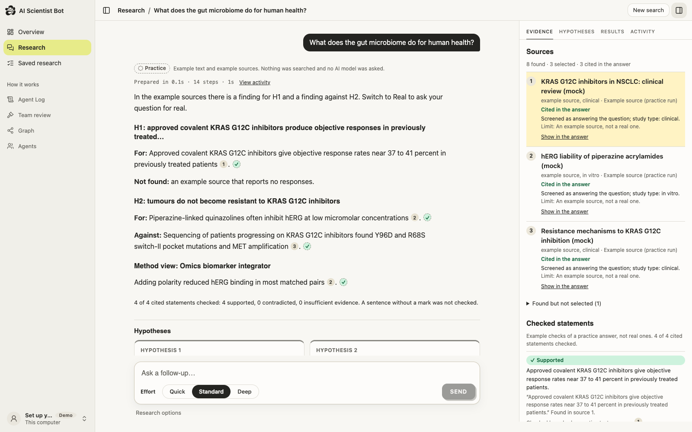
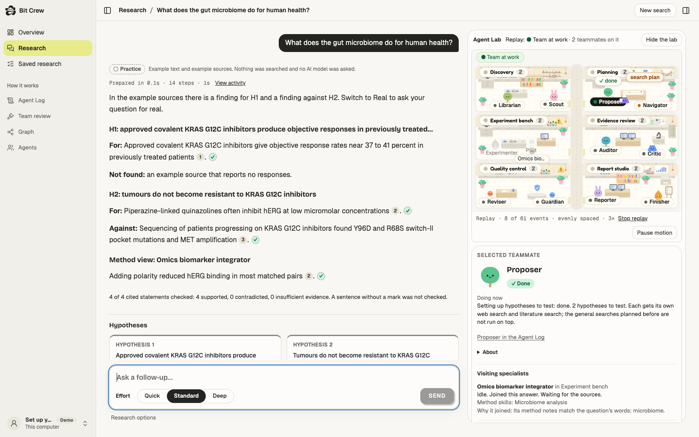
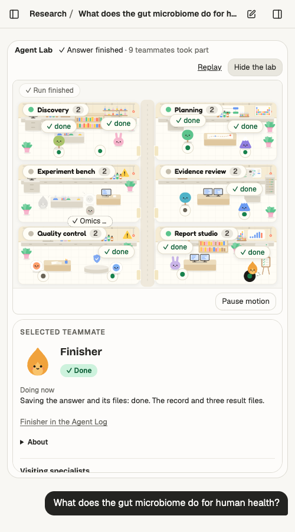
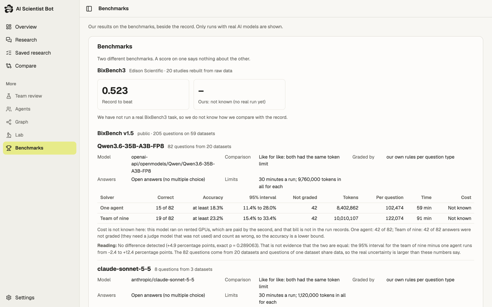
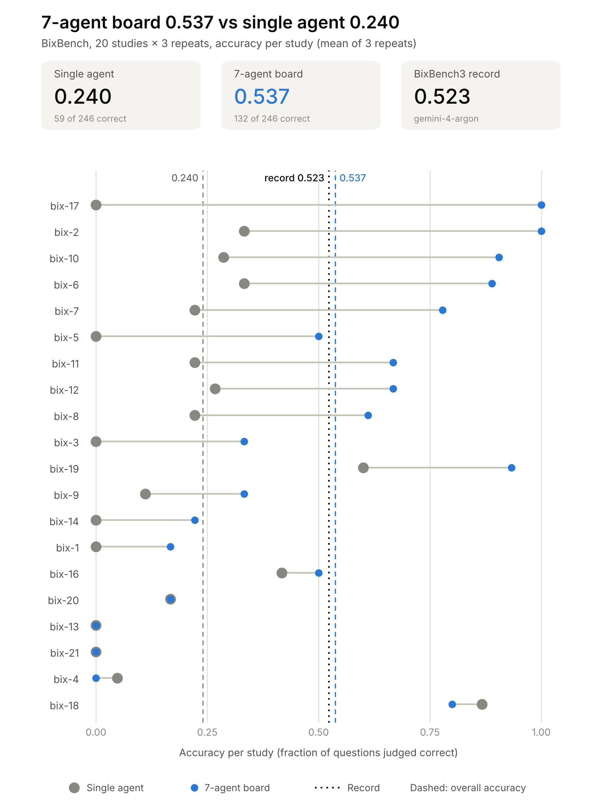
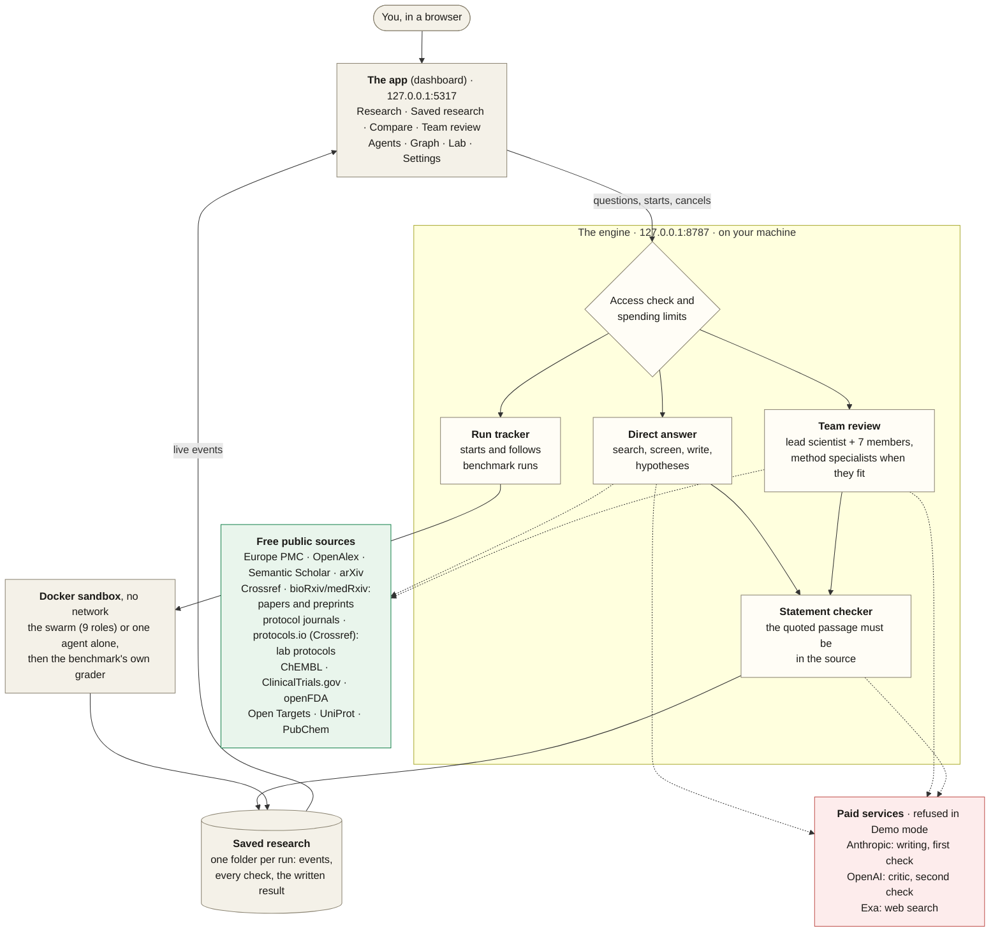

# Bit Crew

**Ask a science question. A team of AI agents researches it. You see what they found, what they
checked, and what is still uncertain.**

Built for the **SF AI Research Hackathon** (Track 3, AI Scientist Swarms) by team GLHF:
Brendan Dang, Anh Lam and Josh Bustamante.

**Contents:** [Try it](#try-it) · [Demo and Real](#demo-and-real) · [What is in the app](#what-is-in-the-app) ·
[Where things stand](#where-things-stand) · [Benchmarks](#benchmarks) · [How it fits together](#how-it-fits-together) ·
[Words](#words) · [Read more](#read-more)

## Why we built it

An AI model can write a confident answer that is wrong. This app does not ask you to trust the
answer. It shows the work:

1. **You ask.** For example: "Should we take this drug candidate forward?"
2. **Agents work on it.** One searches for sources, one plans, one looks for mistakes, one writes.
3. **Statements are checked against their sources.** A second AI model, from a different company,
   must find the exact passage that backs a statement. Each checked statement gets a mark:
   supported, contradicted, or not enough evidence.
4. **You read the result with the marks.** You can open any statement and see who said it, which
   source it cites, and how it was checked.

The app is allowed to say "I do not know" or "nothing was found". That is better than a guess.

## Run it on your machine

You need a terminal, [Node.js](https://nodejs.org) 24 or newer, and [uv](https://docs.astral.sh/uv/).

```bash
git clone https://github.com/itsbrendandang/agent-test.git && cd agent-test
npm run setup    # once, after cloning
cp .env.example .env    # leave the keys blank for Demo mode
npm run engine
```

In a second terminal, in the same folder:

```bash
npm run dashboard
```

Open http://localhost:5317. Press Ctrl+C in both terminals to stop. Restart after `git pull`.
You can also use `npm start` to start both parts and open the browser. It prints the engine's mode, the paid switch,
which keys are set (yes or no) and whether direct answers are on. When an engine was already running on port 8787, it
uses that engine and says so, with a warning when that engine runs other code than this folder or cannot say which
code it runs.

A new copy starts in **Demo mode**. Demo mode is free and needs no account. Its answers are fixed
examples that show how the app works. They are not research.

## Demo and Real

| | Demo | Real |
|---|---|---|
| Answers | Fixed example text | Written by real AI models |
| Sources | Example sources | Real web and literature searches |
| Cost | Free | Costs money, with limits you see before you start |
| Keys needed | None | Your own keys (below) |

### Turn on Real mode

Only the person who pays for the keys does this.

1. **Add your keys.** Copy the example file and paste your own keys after the `=` signs:

   ```bash
   cp .env.example .env
   ```

   | Key | Needed for |
   |---|---|
   | `ANTHROPIC_API_KEY` | The main AI models (writing, first check) |
   | `OPENAI_API_KEY` | The critic and the second check |
   | `EXA_API_KEY` | Web search |

   The other keys in `.env.example` are optional. `HF_TOKEN` is for benchmark data and cloud
   runs, `PAST_API_KEY` for memory between runs. All settings: [docs/configuration.md](docs/configuration.md).

2. **Check the keys.** This is free. It asks each company for its model list and prints the
   spending limits:

   ```bash
   npm run preflight
   ```

3. **Switch to Real.** Choose one:
   - **For this session:** start the app (`npm start`), open **Settings**, and switch Run mode
     from Demo to Real. The app shows the limits and asks you to confirm. A restart goes back
     to Demo.
   - **Every time:** set `NO_PAID_CALLS=0` in `.env`, then start the app again.

Good to know:

- Keys are never stored in this repository. Each person uses their own. Do not share them or
  paste them in a chat.
- A key alone spends nothing. Real mode is off until the person who pays turns it on.
- Each run has a spending limit, and each day has one too. A run is stopped at its limit.
- Tests and coding agents never spend money. `npm run check` forces paid calls off.

The limits in `board/config.yaml` are **$0.15 per Quick answer**, **$0.60 per Standard answer**,
**$5 per team review**, and **$20 per day** across answers, reviews and analyses on Modal. Exa
also has a **$40 lifetime limit** in the engine's search record. These are limits, not price quotes.
The engine checks the team review limits (the `meeting:` section) when it reads the file. A limit
that is not a number (for example `$5`) stops the engine, or the run, with a message that names
the key, so a typo cannot switch the limit off.

### Run the analyses on Modal (optional)

A swarm run runs code: the agents' commands, the checks, and the registered tests that decide
each statement's mark. By default this code runs in a Docker sandbox on your machine. With
`ANALYSIS_BACKEND=modal` in `.env` it runs in a [Modal](https://modal.com) sandbox instead. That
sandbox comes from the BixBench v1 work (PR #32): a checked R and conda image, no network, and
only the case's data files are uploaded.

- It costs Modal credits, also for a practice run. So it is refused while paid calls are off. It
  never moves the work back to your machine on its own: it fails with the reason.
- Each run may cost at most `GLHF_MODAL_MAX_USD` (default $2), and Modal runs count in the $20
  daily limit.
- Each test says where it ran (Docker or Modal, with the sandbox id). The Compare screen and the
  Agent Log show it.
- Set up once: `modal token new`, then `uv sync --group modal --python 3.12` in
  `glhf/bixbench_v1`. `npm run doctor` shows what is missing.

Tested with fakes only; no run has used Modal yet. Details:
[docs/configuration.md](docs/configuration.md#where-the-swarms-analyses-run-analysis_backend).

## What is in the app

The sidebar has two groups. **Overview, Research, Saved research** come first: ask, read, find again.
**How it works** holds Agent Log, Team review, Graph and Agents. Settings opens from the profile row at the foot.
Benchmarks and Compare are not in the sidebar. They open only by their address (`#Benchmarks`, `#Compare`).

| Screen | What it is for |
|---|---|
| Overview | Ask in the "Let's research together!" question box. The answer is written right under the box. Below it, follow the six-room Agent Lab and its activity panel. The answer is also the conversation in Research, so a follow-up there continues it. One quiet line counts research and practice apart. |
| Research | The chat. Ask a question and read the answer with its sources and its hypotheses. An example question fills the box; nothing is sent until you press Send. While the answer is made, the Agent Lab sits beside it (above it on a narrow screen); when the answer is done the Lab folds into one line. |
| Saved research | Search past runs and open any result. The Examples tab has six read-only practice runs. |
| Compare | Not in the sidebar; open `#Compare`. A team of nine agents against one agent alone, on the same task. |
| Team review | One review in detail: the recommendation, how each statement was checked, and the sources. Its discussion is the Agent Log's group chat for that review, with a link "Open in Agent Log". |
| Agents | The agents and what each one does, as member cards grouped by team: the team of nine in step order, the team review with its lead first, then the specialists A to Z. Details opens one member at a time in a side panel, so the other cards keep their size. |
| Graph | One run as a picture of who said what. |
| Agent Log | Every event of the selected run, shown as a group chat. Each agent turn is a message beside the agent's picture and name. Longer reasoning opens with "Show thinking"; other long text, such as an answer draft, opens with "Show more". Tool calls, searches and system steps are small notes between the messages. While a run is live, the log stays on the newest message. One toolbar holds the search box, the Agent and Kind of step menus (each choice with its number of events) and Clear; on the right, Download (JSON or CSV of the shown events). The run menu above it lists runs in progress, then finished runs (research answers, team reviews and task runs), next to Follow newest. A team review shows a "Round n" line where each round begins, the lead and the members as messages, and each statement check as a quiet note with its mark (✓ supported, ✕ contradicted, ? insufficient evidence, ○ not checked). No room picture here; the Lab stays on Overview. |
| Benchmarks | Not in the sidebar; open `#Benchmarks`. Our benchmark results set out as an evaluation: model, accuracy with its interval, tokens, time and cost, beside the record to beat. |
| Settings | Demo or Real, Usage and limits (spent today, the limit per run and per day, Exa search), and Appearance: Light, Dark, or Match system. |

### How the screens connect

The same agent, run, source or statement appears on several screens. Each one links to the others:

- **An agent.** A face or a name in the Agent Log shows only that agent's messages. The line above the log then links
  to its card in Agents (a research answer's steps have no card). A card's Details link to its messages in the Agent Log. In the Overview Lab, the selected
  teammate links to its steps in the Agent Log. In a team review, each member under "Who took part" opens its
  messages, and each name in "The team" opens its card.
- **A run.** The Agent Log links to the run's own screen (Research, Team review or Compare) and to its graph. Team
  review, Compare and the Graph link back to the Agent Log. Each row in Saved research has Agent Log and Graph links.
  An answer in Research has "Open in the Agent Log". Answers have no graph.
- **A source or a statement.** In Research, a citation number opens the inspector's Evidence tab with that source lit.
  "Show in the answer" in the inspector lights the source or opens the statement's check in the answer. On a narrow
  window the citation stays in the answer. In a team review, each source and each checked statement has an "In the
  graph" link that selects its node.

The address bar always says what is shown, so Back, Forward and a copied link return to it:
`#Lab/<kind>/<run id>?agent=<name>`, `#Graph/<kind>/<run id>?node=<node id>`, `#Agents/<name>`, `#Board/<run id>`,
`#Compare/<run id>`. The code is in `dashboard/src/lib/links.ts`.

The Overview Lab has **three rooms across and two down on wide screens**: Discovery, Planning,
Experiment bench; Evidence review, Quality control, Report studio. The activity panel sits
below it. Narrow screens use fewer columns. Agents walk between rooms along the corridors.
The room art is unchanged. The Lab's look is by Anh Lam.

Research answers can add **method specialists** whose skills fit the question. Code matches
the question to their method notes. They write from the sources found; their sections are
checked and reviewed with the rest of the answer. Quick can add one specialist on the cheap
model tier. Standard can add two on the strong tier. If the cheap model is from a different
company than the writer, the specialist uses the writer's model instead. This keeps its
statement checker independent. A question with no match gets none. See
[docs/research-answer.md](docs/research-answer.md#method-specialists).

A **plain factual question**, such as "What is the powerhouse of the cell?", takes a short path
at both levels. The planner marks it simple; health questions never take it. The short path
uses one search, at most 3 sources and a short answer written with little thinking. Each cited
statement is still checked once. It has no hypotheses, specialists, critic or revision. See
[docs/research-answer.md](docs/research-answer.md#the-short-path-for-a-plain-factual-question).

**The answer is written in real time.** While a research answer is made, its text appears as the
writer writes it, under quiet lines that say what the team is doing ("Searching the web: found 6,
kept 4."). The text comes from the engine's own event stream (`answer.delta` pieces; see
[docs/research-answer.md](docs/research-answer.md#the-api)), not from the page. A reconnect or a reload continues the stream where it stopped. A
finished answer is shown at once; it is never typed out again. In Demo mode the scripted writer
gives its fixed text a few words at a time, so the same view can be tried for free. The chat view
for one answer is `dashboard/src/research/LiveChat.tsx` (the AI Elements Conversation and Message,
with the text drawn by streamdown with raw HTML, images and non-web links turned off). Research uses
its status lines and live text for the running answer. Other screens can open it as a live preview
of an answer in progress.

**Try asking** shows biology questions under the question box on Overview and Research. They
come from searches trending on Google now (Google Trends' free feed, no key, read at most once an
hour). A word rule keeps the biology and health searches; no model is called. A question names
only the biology word, never a person in the search. When none is about biology, or the feed
cannot be read, curated biology questions are shown. On Overview and on Research a click fills
the box; nothing is sent until you press Send. If the engine cannot be reached, the older example questions stay.

Research answers search the literature in six free sources at once: Europe PMC (PubMed and
preprints), OpenAlex, Semantic Scholar, arXiv, Crossref and bioRxiv/medRxiv. A source that fails is skipped and named; a
paper found twice is listed once. No key is needed. See
[docs/research-answer.md](docs/research-answer.md#the-flow).

Research answers can also find **lab protocols and SOPs**. When a question asks for a protocol,
an SOP or how to do a lab method ("How do I isolate hepatocytes from mouse liver?"), the answer
also searches published protocols. Three free sources are asked at once: Europe PMC and OpenAlex,
both limited to protocol journals (Bio-protocol, STAR Protocols, Nature Protocols, JoVE, Current
Protocols, Cold Spring Harbor Protocols, MethodsX, Methods in Molecular Biology, and Protocol
Exchange in OpenAlex only), and protocols.io through Crossref. No key is needed. The
protocols.io API itself needs a token, so it is not used. A protocol is marked "protocol" in the
sources and cited like a paper. Only its abstract is read, not its steps. See
`engine/src/search/protocols.ts`.

Headings use **Bricolage Grotesque**. Cards have rounded corners and offset sticker shadows.
Body text stays Geist. Fonts ship with the dashboard; none are loaded from an outside font
service. Light is the default. Dark and Match system are in Settings → Appearance.

### Example library

Saved research → Examples has six committed Demo runs:

1. **GLP-1 market** — a Quick answer.
2. **Safety and specialists** — hERG risk for KRAS G12C inhibitors, with method specialists.
3. **Hypothesis investigation** — KRAS G12C response and resistance.
4. **Clinical evidence** — KRAS G12C inhibitors in previously treated lung cancer.
5. **Stopped research** — a cancelled answer about KRAS G12C safety and resistance.
6. **KRAS G12C board review** — the bundled team review, through its written recommendation.

Each is labelled **"Example · practice, $0"**, including downloads. They are read-only: they
cannot be changed, deleted, resumed or replayed. They are not counted in totals or spending.
Open them in Research or Team review, the Agent Log, or the Overview Lab.

Set `GLHF_HIDE_EXAMPLES=1` before starting the engine to hide them. To replace the committed
files in `examples/` with fresh scripted Demo runs, make sure port 8812 is free, then run:

```bash
node scripts/generate-examples.mjs
```

The script starts its own engine with paid calls off and locked. It makes the events through
the Demo pipeline, not by hand. These are practice runs, not research or benchmark results.

### Earlier Demo screenshots

The Overview, Research, Team review and Lab pictures below show earlier layouts in **Demo
mode**. They are practice runs: fixed example text, not research. The app labels them "Practice".
The Benchmarks picture is described separately.

**Overview.** Practice runs are counted apart from research, so the big number is only what real
models produced.


**Research.** You ask; the answer is split into hypotheses, each with the sources for and against
it. A mark that rests on one source only says so ("one source only").



**Research's live Agent Lab.** While an answer is made, the conversation is on the left and the
Agent Lab is on the right. A narrow screen puts the Lab above the conversation. When the Lab sits above the conversation
and is narrower than 480 px, the agents' name tags are hidden so they do not overlap; click an
agent's dot to see its name. Beside the conversation the name tags always show. The Lab uses the same
scene as the Overview. Agents move only for steps the engine reports. Agents with no step stay at
their desks. Click an agent to see what it is doing. "Hide the lab" folds it into one line. The
browser remembers this choice for the next answer. When the answer is done, the Lab folds by itself.
"Show the lab" opens it again, and "Replay" plays the recorded events again. A Demo answer is
finished in a fraction of a second, so the Lab replays a new Demo answer once, labelled "Replay".
"Pause motion" stops all movement. With the system's reduced-motion setting, nothing moves and
nothing replays by itself. Code: `dashboard/src/research/ResearchLive.tsx`.





**Team review.** The decision first, then how many statements were checked and how each one did.


**Overview's Agent Lab.** The same run as a scene: who is working and who fetched what.
This earlier picture shows the room art, not the current three-column layout or the Agent Log.


**Benchmarks.** These numbers are real runs, read from the run records. Where something was not
measured the screen says "Not known".



## Where things stand

We say only what was really done.

- **Works today:** the app, Demo mode, and a full practice review from question to written
  recommendation.
- **Tested with real AI models, in a small way:** a team of agents and one agent alone both worked
  on 8 benchmark questions. They scored the same (4 of 8), and the team cost more.
- **Done on BixBench3:** one run. A 7-agent team scored 0.537 (132 of 246), above the
  record of 0.523; one agent alone scored 0.240. See [Benchmarks](#benchmarks).
- **Not done yet:** a BixBench3 run of the nine-role swarm in this repo.
- **Done once:** a team review with real AI models from start to end. It made 3 web searches
  (Exa) and 5 literature searches, and checked 204 statements: 71 supported, 28 without enough
  evidence, 105 not checked (75 of those are calculations, which the checker cannot re-run), none
  contradicted. It cost $1.31 and took 8 minutes. One run is not evidence that the reviews are
  good.
- **Built, and tested in Demo mode only:** the direct answer in the chat (numbered sources,
  visible steps, hypotheses with sources for and against), and the Lab. No real AI model has
  written a direct answer yet; a real one stays switched off until we turn it on.
- **Open models on Modal:** one open model (Qwen3.6 35B) was served on Modal and ran 82 benchmark
  questions (see Benchmarks). More models are listed in `glhf/openmodels/models.yaml` but are
  switched off.
- **Being built now:** a shared store for what the agents find. Today each run keeps its own
  folder of files; there is no database yet.
- **Memory between runs (past.dev):** wired into the nine-agent swarm only, and a person must
  approve each lesson before it is saved. It has not been used in a full real run. The team
  review and the chat do not use it.

The exact list, with what was tested and how, is in [docs/status.md](docs/status.md).

- **Local shakedown (2026-11-15):** a fresh clone was set up, the test suite, the scripted demo
  (score 1.000), and the web UI all ran on macOS. The full write-up, including what did not work,
  is in [TEST-FINDINGS.md](TEST-FINDINGS.md).

## The brief: Track 3, AI Scientist Swarms

The hackathon's instructions for the track we entered, as given:

> **The question:** can a team of agents reproduce a full computational biology study from raw
> data better than the best single frontier model?
>
> **What to build:** generating hypotheses is the easy part, rejecting the wrong ones is harder.
> Build a multi-agent system where agents with different roles (proposer, experimenter, critic)
> plan, run the analysis and check each other's results before anything is reported.
>
> **Record to beat:** BixBench3 (Edison Scientific), 20 published studies rebuilt from raw data.
> Best score: 0.523.
>
> **Context:** Kosmos (Edison Scientific, 2025) coordinates 200+ agents through a shared world
> model, and independent scientists judged 79.4% of its statements accurate, so about 1 in 5 is
> wrong. Popper (Huang et al., ICML 2025) has agents design falsification experiments with
> Type-I error control.
>
> **Judged on:** score vs. the record and a single-agent baseline on the same compute budget,
> rigour, reproducibility. Report what the swarm rejected as well as what it found.

## Benchmarks

A first report, in words. Charts and a fuller scope come later.

**Two benchmarks, and they are not the same thing.**

| | BixBench3 | BixBench v1.5 |
|---|---|---|
| Who made it | Edison Scientific | FutureHouse (public dataset `futurehouse/BixBench`) |
| The task | Rebuild a published study from raw data: 20 studies | Answer questions about a dataset: 205 questions on 59 datasets |
| Record | 0.523, the number Track 3 asks us to beat | Published numbers exist, but ours cannot be set beside them yet (see below) |
| Our solver | Nine-role swarm, in `glhf/bixbench/` | Three-role swarm (analyst, blind critic, reconciler), in `glhf/bixbench_v1/` |
| Compared with | One agent alone, same model | One agent alone, same model, same token budget by default |

**What we have run with real AI models.**

| Benchmark | What was run | Result |
|---|---|---|
| BixBench3 | One run: a 7-agent team and one agent alone, 20 studies, 246 questions, each run 3 times. | One agent: 59 of 246 (0.240). 7-agent team: 132 of 246 (0.537). Record: 0.523. See below. |
| BixBench v1.5 | A pilot: 3 datasets, 8 questions, `anthropic/claude-sonnet-5-5`. | One agent: 4 of 8 correct, 317,110 tokens. Swarm: 4 of 8 correct, 532,394 tokens (about 1.7 times). |
| BixBench v1.5 | 20 datasets, 82 questions, an open model (Qwen3.6 35B) served on Modal, same token limit for both. | One agent: 15 of 82. Swarm: 19 of 82. No difference detected (exact p = 0.29). 42 of the 82 answers were not graded, because no judge model was used; they count as wrong, so both scores are lower bounds. |

The Benchmarks screen in the app (address `#Benchmarks`) shows these rows with their intervals, tokens and time.

**BixBench3: a 7-agent team against one agent.** Our goal is to beat the record (0.523). This run
reports the 7-agent team at 0.537, just above the record, and one agent alone at 0.240. The team
scored higher on 15 of the 20 studies, the same on 3, and lower on 2 (bix-4 and bix-18). Each
study's score is the mean of 3 repeats.



Eight questions are far too few to tell the two apart. The pilot also used an older swarm; it
has changed since, and the changes were tested with a scripted model only, not a real one. We
also ran a small practice case of our own with both solvers. That checks that the system works;
it is not a benchmark result.

**How a comparison is kept fair.** This follows what Track 3 is judged on.

- **Same compute budget.** By default the swarm gets the same token total as the single agent.
  A run where the swarm got more is labelled "more budget" and reported apart.
- **Same rules for both.** Same model, sandbox, tools, instructions and time limit. Both get
  the same last turn to record answers when the budget ends.
- **No answers in reach.** The answer key never enters the sandbox or the prompt. Only data
  files are copied in; solution notebooks and write-ups are left out.
- **What was rejected is reported.** Each swarm run lists the answers it threw out and why,
  next to the answers it kept. In the nine-role swarm, a claim that a test rejects also sends the
  files it rests on back for a fix (tested with the scripted model only).
- **Honest statistics.** Each report says how it was graded and whether its numbers can be
  compared with published ones. Today the answer is "no", with the reasons: for example, our
  sandbox has no network and the official one does. Questions that share a dataset are not
  counted as independent evidence.
- **Reproducible.** Every run records its settings, seed, sandbox image and token use.

**What comes next.** A full run of both solvers on one benchmark at the same budget, then
charts of score, cost and what the swarm rejected. The BixBench3 run already shows a team ahead of
one agent (0.537 against 0.240).

Details: [docs/status.md](docs/status.md), [glhf/bixbench_v1/README.md](glhf/bixbench_v1/README.md),
[docs/reading-results.md](docs/reading-results.md).

## Sponsor tools

What we were given, and what this project really uses. "Called" means a real request was sent.

| Tool | What we use it for | Really called so far? |
|---|---|---|
| [Exa](https://exa.ai) | Web search. The scout agent opens a review with it. The benchmark agents can search tool documentation with it. | Yes. One real team review made 3 searches and checked statements against the pages found. Before that, three searches by hand. |
| [past.dev](https://past.dev) | Long-term memory for the benchmark agents: lessons a person approved are saved and recalled. | Yes, saving and recalling were tested by hand. No full run has used it yet. |
| OpenAI | The second checker and the critic agent (a different company from the main model, on purpose). The judge that grades benchmark answers. | Yes. It made 12 second checks in the one real team review, and `gpt-4o` graded the 8 pilot questions. A teammate's separate baseline also used it. |
| [Modal](https://modal.com) | Cloud computers: to run the analyses (the sandbox for agents' commands, checks and registered tests), to run open models next to Claude and OpenAI models on the benchmark, and to host the app. | Partly. The app is hosted there in Demo mode behind a sign-in (no keys, practice runs only; see below). One open model (Qwen3.6 35B) was served there for 82 benchmark questions; see [glhf/openmodels/README.md](glhf/openmodels/README.md). The BixBench v1 adapter's sandbox ran there with the scripted model and in the billed cloud tests. Swarm runs on Modal (`ANALYSIS_BACKEND=modal`) are tested with fakes only. |
| Tinker (Thinking Machines) | Not used. | No. No code calls it. |

The main AI models are Claude models from Anthropic (not a sponsor credit). They were called for
the 8 pilot questions and for one chat question.

**Hosted on Modal (Demo mode).** The app also runs as one private web address on Modal:
`deploy/modal_host/`. The owner gives each teammate a personal access code; nothing is served
without sign-in. The hosted engine has no API key: it does practice reviews and demo answers only,
and says so. Runs are kept on a Modal Volume and survive a container stop; a review that was cut
off continues at the next visit. Swarm and benchmark runs are not available there yet. The
container stops after five idle minutes and then costs nothing. Deploy, access codes, cost and
limits: [deploy/modal_host/README.md](deploy/modal_host/README.md). Real mode in the cloud is
designed, not deployed: [deploy/modal_host/REAL-MODE.md](deploy/modal_host/REAL-MODE.md).

### How Modal, Exa and past.dev work in the system

The table above says what has really been called. This part says how each tool is built in.
Each tool has one job: **Modal** gives the compute to run experiments, **Exa** finds the
evidence to sort hypotheses, and **past.dev** carries memory from one run to the next.

**Modal: faster experiments.** An experiment is the code a run executes: the agents' commands,
the checks, and the registered tests that decide each statement's mark.

- **Cloud sandboxes in place of your machine.** With `ANALYSIS_BACKEND=modal` (swarm) or
  `--sandbox modal` (BixBench adapter), every command runs in a Modal sandbox instead of local
  Docker.
- **One image, built once.** The analysis image (R, 843 pinned conda packages, BUSCO) is built
  once on Modal. Each new sandbox starts from it, with no setup on anyone's machine.
- **Data uploaded once.** Each dataset goes once to a Modal Volume. Every sandbox reads it from
  there, so upload time does not grow with the number of sandboxes.
- **Many runs at once.** `--jobs N` starts N runs together, each with its own sandboxes. A full
  set then takes about 1/N of the time for about the same sandbox cost. The limits reserve each
  running run's worst case, so running in parallel cannot overspend. (On Modal this is tested
  with fakes only so far.)
- **Open models on GPUs.** Open models are served on Modal GPUs (vLLM, stopped when idle), so
  they can answer the same questions as the Claude and OpenAI models.
- **Safe by default.** A sandbox has no network and no keys, and holds only the task's data.
  Each run has a dollar limit (`GLHF_MODAL_MAX_USD`), and Modal counts in the daily limit.
  Sandboxes are stopped when a run is cancelled.

Code: `glhf/bixbench_v1/src/bixbench_v1/` (`modal_sandbox.py`, `modal_image.py`,
`modal_stage.py`, `jobs.py`), `glhf/openmodels/`, `deploy/modal_host/`.

**Exa: triaging hypotheses.** Exa is the first search behind every hypothesis. It decides
which hypotheses get tested, and gives the evidence each one is marked on. In a Standard
research answer:

1. **Hypotheses come first.** Before any search, the planner sets 2 to 4 competing hypotheses.
   For each one it writes what a source would report if it holds (`supportIf`) and if it does
   not (`contradictIf`).
2. **The search budget picks which are tested.** Each hypothesis needs its own Exa search, and
   an answer has at most 3. So at most 3 hypotheses go forward. The others are named under
   "What is missing".
3. **One investigator per hypothesis.** The investigators work at the same time. Each starts
   with its own Exa search, then free literature searches. It screens what it finds against its
   own hypothesis only, and files sentences under **For** or **Against**.
4. **Code gives the mark, not a model** (`markOf`). A sentence counts only if it passes the
   quote check against its source, and a model from another company, not told the side, agrees
   which way it points. The marks: Supported, Contradicted, Insufficient evidence (also "the
   sources disagree") and Not checked. A mark that rests on one source is flagged as thin.

In a team review, the scout opens every review with one Exa search. It is the only member with
that tool, and the evidence verifier rechecks its sources. In the swarm, agents get
`search_docs`: Exa limited to 9 software documentation sites, so it finds tool manuals, never
answers. Every Exa search goes through a spend record with a lifetime limit.

Code: `engine/src/search/exa.ts`, `engine/src/research/pipeline.ts` (`markOf`),
`engine/src/board/agents.ts`, `engine/src/paid/exaledger.ts`,
`glhf/bixbench/src/bixbench3/inspect_harness/swarm/tools.py` (`search_docs`). Details:
[docs/research-answer.md](docs/research-answer.md).

**past.dev: memory for the roles.** Each of the swarm's nine roles starts with an empty
context, so without memory every run would repeat the same setup mistakes. Lessons go around a
loop:

1. **Written.** At the end of a run, the reporter writes at most 8 one-line process lessons:
   tool problems and their fixes, file-format pitfalls, what took the time.
2. **Filtered.** Code drops any line that looks like a result (numbers, gene or sample names,
   scores, answers).
3. **Approved.** A person reviews each lesson. Only approved lessons are sent to past.dev.
4. **Recalled and ranked.** When a new run starts, the swarm asks past.dev with a fixed
   question. The task text is never sent. past.dev ranks the stored lessons.
5. **Given to every role.** Lessons from the same task are dropped, so a run cannot learn its
   own answer. The rest are added to each role's instructions with the note "check before
   relying on them".

If past.dev cannot be reached, the run uses the local file of approved lessons and goes on.

Code: `glhf/bixbench/src/bixbench3/inspect_harness/swarm/` (`past_memory.py`, `memory.py`,
`solver.py`). Details: [glhf/memory/README.md](glhf/memory/README.md).

## How it fits together

You use the app in a browser. The app only talks to the engine on your own machine. The engine
holds the keys, enforces the spending limits, and is the only part that reaches outside services.



Solid arrows stay on your machine. Dotted arrows leave it, and only the engine sends them: the
red box costs money and is refused in Demo mode; the green box is free. In a team review the scout
gathers the sources, and the evidence verifier rechecks them in every round with its own free searches. The swarm's sandbox has no network at all. A direct answer written
by real models is built but still switched off (see "Where things stand").

The engine is built on a durable agent harness ([Pi Durable](docs/pi-setup.md)). Every step is
saved as it happens. A review that is interrupted, for example by a crash or a restart, continues
where it stopped and does not repeat (or pay again for) finished work. We tested this by stopping
a practice review in the middle. A review counts as finished only when the lead has written its
memo. If the lead stops without one, the review is marked failed, not finished. A resume does not
ask the lead again, so start a new review. A review whose `overrides.json` (the limits its chat plan
set) cannot be read is also marked failed and does not start.

The saved research is kept as files on your machine. The engine can also keep a copy in a
Supabase database: set `SUPABASE_URL` and `SUPABASE_SERVICE_ROLE_KEY` in `.env`, and run
`npm run db:backfill` once. It is off by default. See [docs/database.md](docs/database.md).

## Words

| Word | Plain meaning |
|---|---|
| Agent | One AI model given one job and its own instructions. |
| Team review | Agents discuss a written question in rounds, and a lead agent writes a recommendation. In the code it is called "board". |
| Swarm | A team of agents that works through a data-analysis task in a fixed order. |
| Single agent | One AI model doing the whole task alone. We compare the team against it. |
| Practice run | A run in Demo mode, with fixed example answers. Free. Not research. |
| Real run | A run that uses real AI models. It costs money. |
| Benchmark | A public set of tasks with known answers, used to measure a method. Ours is BixBench (biology data analysis). |
| Engine | The program on your machine that runs everything and guards the spending. |

## Check that your copy is healthy

```bash
npm run check    # about 3 minutes; never spends money
```

It prints one line per part, `ok` or `FAIL`. All five parts should print `ok`: no
merge-conflict markers, both type checks clean, engine tests and dashboard tests pass.
If a line says `FAIL` on your copy, run `npm run setup` again first. More about the tests is in
[docs/developers.md](docs/developers.md#tests).

## Working with the Pi coding agent

With [Pi](https://pi.dev) installed, run `pi` in this repository's root. After you trust the
project, it reads `.pi/settings.json`: skills from `.agents/skills/` and the pinned `pi-agents`
package. The profiles in `.pi/agents/` are **advisor**, **dashboard-qa**, **docs-writer** and
**reviewer**. `AGENTS.md` rules apply. The agent never turns paid calls on. Pi uses its own
model account; it is separate from the app's free Demo mode. See [docs/pi-setup.md](docs/pi-setup.md).

## Read more

| If you want to | Read |
|---|---|
| Set up your machine and contribute | [CONTRIBUTING.md](CONTRIBUTING.md) |
| Understand the folders and where new code goes | [docs/codebase.md](docs/codebase.md) |
| See every command, the two parts of the project, the tests and the limits | [docs/developers.md](docs/developers.md) |
| Know exactly what was tested | [docs/status.md](docs/status.md) |
| Keep a copy of the records in Supabase | [docs/database.md](docs/database.md) |
| Understand a team review and what "supported" means | [docs/drug-board.md](docs/drug-board.md) |
| Read results and compare fairly | [docs/reading-results.md](docs/reading-results.md) |
| Use a coding agent on this repository | [AGENTS.md](AGENTS.md) |

## Limits you should know

- "Supported" means a second AI model found a real passage in the source, with the same numbers.
  It does not prove the passage is right, or that the source is good.
- Searches return summaries and short excerpts, not full papers. A true statement can still end
  as "not enough evidence".
- This is a research aid. It does not replace an expert, and it is not medical advice.

## Licence

Our own code is under the MIT licence (`LICENSE`). Two folders are not: `glhf/bixbench/` is a
modified copy of BixBench3 (Edison Scientific, CC BY-SA 4.0; our changes are listed in
`glhf/bixbench/CHANGES.md` and carry the same licence), and `glhf/bixbench_v1/` depends on it and
is offered under CC BY-SA 4.0 as well. Third-party files keep their own terms.
