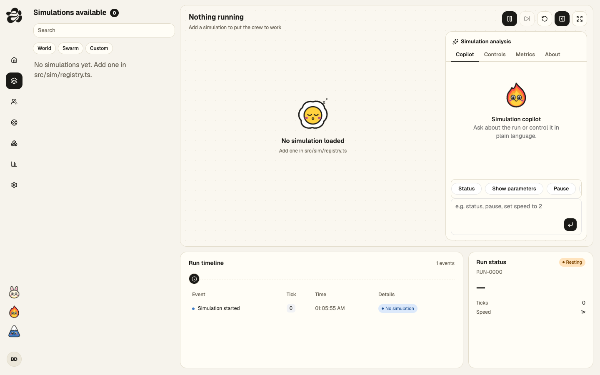

# Sim Lab: desktop dashboard skeleton (draft)

A desktop dashboard for hosting simulations (world simulations, agent swarms, anything that
steps over time). This repo is the **UI skeleton** only: no simulations are registered yet.



## Stack
| Layer | Library |
|---|---|
| Desktop shell | [Tauri 2](https://tauri.app) (Rust) in `src-tauri/` |
| UI | React + Vite + TypeScript |
| Controls | [ui-sdk](https://ui-sdk.dev) (`@ui-sdk/react`): tabs, sliders, switches, toolbar |
| Copilot chat | Vercel [AI Elements](https://github.com/vercel/ai-elements) in `src/components/ai-elements/` |
| Charts | [Recharts](https://recharts.org) via shadcn/ui `chart` |
| Styling | Tailwind CSS 4 + shadcn/ui tokens |

## Run
```bash
npm install
npm run desktop         # desktop window (needs Rust: brew install rustup && rustup default stable)
npm run dev             # browser only, http://localhost:5173
npm run desktop:build   # packaged app
```

## Views
The left rail switches views (also reachable by URL hash, e.g. `#Analytics`). The dashboard is kept
minimal on purpose; the characters carry the personality.

- **Overview**: landing page with live CPU and GPU bars (desktop app only), session counts, and run
  history: totals, success rate, a GitHub-style activity graph, and results per AI model. Runs are
  recorded with `recordRun()` in `src/runs/store.ts`; nothing calls it yet, so it starts empty.
- **Simulations**: simulation cards, the canvas, an inspector (Copilot / Controls / Metrics / About),
  a run timeline and a run-status card.
- **Agents**: crew editor. Give each character a name, a role, a look (built-in or an uploaded image)
  and a `SKILL.md` (write your own, import one, or start from a suggested starter), and send the crew
  onto the desktop. Skills are saved with the crew but no agent reads them yet.
- **Analytics**: charts for every metric the simulation reports, plus events by type.
- **Settings**: connect and test API keys for OpenAI, Anthropic, xAI and Google Gemini. Keys are stored in
  the macOS keychain by the Rust side and never returned to the window. Desktop app only.
- **Worlds, Experiments**: empty placeholders.

## Characters
- `src/components/Buddy.tsx`: SVG characters (bunny, flame, egg, mountain, sprout) with four moods.
- `src/crew/`: the crew store (saved in localStorage) and the **desktop overlay**: a transparent,
  always-on-top, click-through window where the crew strolls along the bottom of the screen and
  carries notes to each other. Click a character for its panel.
- The characters are **not connected to AI agents yet**; they only play.

Easter eggs (in the side rail):
- Poke a character and it talks back. Poke it five times fast and it looks startled.
- Leave the app alone for 45 seconds and they fall asleep.
- Click the logo five times and the crew strolls across the window.

Animation is kept deliberately simple: every character breathes and blinks; on the desktop they stand,
stroll, carry a note to a teammate, and do a small hop when it arrives.

## Add a simulation
1. Copy `src/sim/sims/template.ts`.
2. Implement `init`, `step`, `draw`, and optionally `metrics` and `drainEvents`. Declared `params`
   become controls automatically; keys in `resetOn` restart the run when changed.
3. Import it in `src/sim/registry.ts` and add it to the `simulations` array.

## Copilot
`src/agent/copilot.ts` is a local placeholder (no model, no API key). It answers status questions and
runs `pause`, `play`, `reset` and `set <parameter> to <value>`. Swap it for the AI SDK's `useChat`
and expose the same actions as tools to use a real model.

## Not wired yet
- Real agents behind the characters, characters sitting on other apps' windows, and sprite-sheet
  animation for uploaded characters.
- `research/` is an empty home for the Python research code. The planned link is for the Rust side
  to start a Python process and stream frames, metrics and events into the dashboard.
- No tests yet.

## Structure
```
src/
├── App.tsx                   # shell: rail, views, simulations layout
├── index.css                 # layout + theme tokens
├── agent/copilot.ts          # placeholder copilot logic
├── components/               # SimCard, Timeline, ParamPanel, MetricsChart, CopilotPanel
│   ├── ai-elements/          # Vercel AI Elements (generated)
│   └── ui/                   # shadcn/ui (generated)
├── crew/                     # crew store, desktop overlay window
├── views/                    # Overview, Agents, Analytics, Placeholder
└── sim/
    ├── types.ts              # Simulation contract
    ├── registry.ts           # simulations shown in the app
    ├── useSimulation.ts      # run loop, metrics history, events
    ├── empty.ts              # fallback shown while the registry is empty
    └── sims/template.ts      # starting point for your own (not registered)
src-tauri/                    # Rust desktop shell
research/                     # Python research code (placeholder)
```
