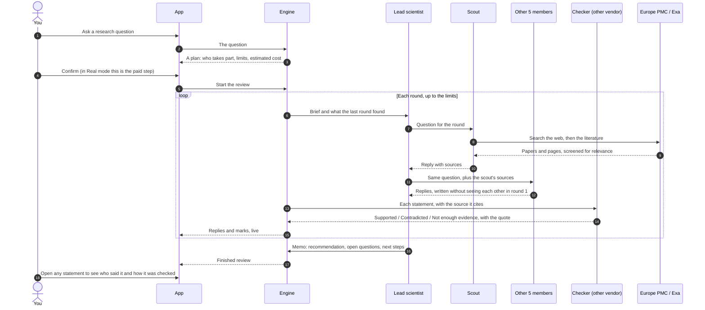

# For developers and teammates

The [README](../README.md) is the short, plain introduction. This page holds the detail: the two
parts of the project, the paid-calls switch, the exact status, the commands, where things are, the
tests and the known limits. To set up your machine, read
[CONTRIBUTING.md](../CONTRIBUTING.md). For a map of the folders, read [codebase.md](codebase.md).

## Two parts, one engine

1. **GLHF swarm.** A solver with nine roles for Edison's BixBench3 benchmark. The nine roles are
   nine phases with their own instructions. Only the solver is ours. The sandbox, time limit,
   grader and judge are the benchmark's own code.
2. **Board review.** A lead scientist agent and six members discuss a written brief in rounds
   and the lead writes a memo. The members are the scout, proposer, experimenter (one agent with
   three modes: Pilot, full run, Reviser), methods auditor, critic and reporter. They are prompts
   only and run no code. One member, the scout, can search: the web (Exa, paid) and the literature
   (PubMed and preprints through Europe PMC, free). It replies first, so the others see its
   sources. Each statement a member makes is checked by a model from a different vendor, which
   must quote the source. The team is the `board:` list in `board/config.yaml`; **keep the scout
   on it**, or a review gathers no sources. See
   [docs/drug-board.md](drug-board.md).

Both are tracked by one engine (`engine/`, port 8787) and shown in one app (`dashboard/`, port 5317).

**One team review, step by step.**



A statement is marked "supported" only when the checker quotes a passage and code finds that passage,
with the same numbers, in the cited source. The order of steps, the limits and the marks are set by
code; no model decides them.

## Paid calls are off on a new clone

A new clone can only do scripted runs (`--model mock`). They cost nothing. Everything that
costs money is refused by the engine until a person turns it on, in one of two ways:

- **In the app:** the Demo/Real switch in Settings (`GET`/`POST /api/paid`). It needs the
  session token and a confirmation, checks that the keys are present, writes an audit line for
  every change, and goes back to the `.env` value when the engine restarts.
- **In `.env`:** write the line below and start the engine again.

```
NO_PAID_CALLS=0
```

`PAID_SWITCH_LOCKED=1` disables the in-app switch, so only `.env` decides. Tests and CI set it.

| | |
|---|---|
| Who may set it | Only the person who pays for the API keys. A coding agent never sets it, never uses the switch and never runs `npm run preflight`. |
| Where it is read | First the process environment (an exported value wins), then `.env`. |
| When is the switch on | Always, unless the value is exactly `0`. No value, `1`, `true` or a typing mistake all mean: no paid calls. |
| Refused while on | Runs with a real model, cloud runs, Exa search, the board's real models and its claim checkers. The Home chat answers with a word search or fixed text, with no model. |
| Still works | `npm run demo`, runs with `--model mock`, the scripted board review, the dashboard, all tests. |
| Python commands | Covered too: `uv run bixbench3 run`, `python -m bixbench3.glhf_local` and `uv run bixbench-v1 run` refuse a real model, a cloud launch and Exa in the same way. |
| **Not covered** | `inspect eval` on `inspect_harness/tasks.py`, and scripts that call `run_capsule`, `InspectJudge`, `GCPRunner` or `exa_docs` directly. Credentials other than seven named provider keys (Google, AWS, Azure, a saved Hugging Face login). A cloud run that is already on its virtual machine. |

With paid calls on, a board run with a missing key stops at the start and names the key. It does not
fall back to a practice run. A vendor that rejects a key or a model name ends the run at once, and the
run is shown as failed. For a first real run, lower the cap: `npm run board -- run <brief> --max-usd 0.5`.

Two known gaps of the in-app switch: any program running as you can read the session token file, and a
cloud run that is already started keeps billing after a switch back to Demo.

Details: [docs/running.md](running.md#paid-calls-no_paid_calls).

## Status

Read this first. It says what was really done.

| Item | Status |
|---|---|
| Swarm and single agent on the demo case, scripted model | Works. Covered by automated tests and `npm run demo`. |
| Swarm and single agent on the demo case, real model | Done once each. Both scored 1.0. The swarm used about 15 times the tokens of the single agent. |
| Board review, scripted | Works. A practice run with the default members shows statements that hold up, one proven wrong, and some with too little evidence. |
| Board review, real models | **Never run.** The board calls Anthropic and OpenAI directly. `npm run preflight` found the configured model names on both accounts (a free check). One real chat question was answered with a plan (a small model call). The cost per review and the quote check are not proven with a real run. |
| A direct answer with sources in Search | **Being built.** Not in `main` yet. |
| Evidence for the board | Built and tested with practice runs and a fake network. The scout has three search tools, used in this order: `exa_search` (paid, at most 20 a run and $40 in total; one live search was made by hand to check the key), `literature_search` (Europe PMC, free; one live query was tried by hand) and `database_search` (ChEMBL, ClinicalTrials.gov, openFDA, Open Targets, UniProt, PubChem: free, no key; each was queried by hand, and the tests use the saved answers). Results are screened and shown to the other members, and each source keeps the search and the query that found it. One real review (run `202611150251-kras-g12c-hit-to-lead`) made 3 web searches and 5 literature searches. **No real review has used `database_search`.** |
| A real BixBench3 task | **Not done.** There is no benchmark score to report. |
| Cloud run on Google Cloud | **Not done.** Google Cloud is not set up. |
| Public BixBench dataset (`futurehouse/BixBench` v1.5, 205 questions, 59 data capsules) | Adapter built and tested with the scripted model. A small pilot with a real model ran (3 capsules, 8 questions) with the older swarm. The swarm was changed after it; the changes are tested with the scripted model only. **The full run is not done.** See [BixBench v1 adapter](#bixbench-v1-adapter). |

The demo case is a small built-in test case. It is not a benchmark task, so a demo score is not a
benchmark score. Full details: [docs/status.md](status.md).

## Words used in these documents

The developer list. The plain list is at the [top](../README.md#words).

| Word | Meaning |
|---|---|
| Swarm | The GLHF solver with nine roles (`--solver glhf`). |
| Single agent | The benchmark's own solver with one agent (`--solver single`). It is our baseline. |
| Role | One agent in the swarm. Each role has its own instructions and starts with an empty context. There are nine roles in four model groups (planner, experimenter, critic, reporter). A role is not a separate model: with one `--model`, all nine use it. |
| Phase | One turn of one role inside a run, for example `critique 2`. |
| Artifact | An output file that the task requires. The grader scores artifacts. |
| Claim | A statement about the results that can be tested, with a null hypothesis. |
| Ledger | The shared record of a run: claims, registered tests, results, issues and events. File: `ledger.json`. |
| Registered test | A test that the Critic names and describes before it runs any test of that claim. Only registered tests can support a claim. |
| Verdict | The result for a claim: supported, refuted, insufficient or untested. Code computes it. |
| Demo case | The small test case in `glhf/demo_case/` (3,598 reads, 4 samples, 2 required tables). |
| Scripted model | `--model mock`. It replays fixed steps and needs no key. It tests the code, not the science. |
| Engine | The Node.js backend in `engine/`. It tracks runs and serves the API on port 8787. |
| Dashboard | The web UI in `dashboard/`, on port 5317. |
| Run tracker | The part of the engine that starts a run, follows it and records the grade. |

## The nine roles

```
Scout -> Proposer -> Pilot -> Experimenter -> [Methods Auditor -> Critic -> Reviser] -> Finisher -> Reporter
                                               repeated, at most 3 rounds by default   only if an
                                                                                        artifact is
                                                                                        missing
```

| Role | What it does |
|---|---|
| Scout | Lists the inputs, the sample mapping and the installed tools. |
| Proposer | Writes the plan and registers 3 to 8 claims. |
| Pilot | Runs the whole pipeline on a small subsample, so format and tool errors appear early. |
| Experimenter | Runs the full analysis and writes every artifact. |
| Methods Auditor | Compares the scripts with the task's Method Guidance. Raises issues. |
| Critic | Registers tests for each claim, then runs them. Raises issues. |
| Reviser | Fixes the open issues. |
| Finisher | Runs only if an artifact is still missing or unreadable after review. |
| Reporter | Writes `METHODS.md` from what was really run. This phase always runs. |

The order of roles, the budgets and the verdicts are fixed in code. No model decides them.
Design and diagrams: [glhf/docs/DESIGN.md](../glhf/docs/DESIGN.md).

## How to run

```bash
# Demo case with a real model, swarm and single agent. Needs NO_PAID_CALLS=0 in .env and a token budget.
npm run glhf -- run --mode local --solver glhf   --model anthropic/claude-sonnet-5-5 --max-tokens 400000 --follow
npm run glhf -- run --mode local --solver single --model anthropic/claude-sonnet-5-5 --max-tokens 400000 --follow

npm run glhf -- list            # all runs
npm run glhf -- show <run-id>   # one run: phase, score, claims, issues
npm run glhf -- cancel <run-id> # stop a local run
npm run scoreboard              # single agent and swarm side by side
```

All commands, flags and the rules for cloud runs: [docs/running.md](running.md).

Rules for local runs (details: [docs/running.md](running.md#run-control)):

| Rule | Detail |
|---|---|
| One local run at a time | A second start is refused until the first run ends or is cancelled. |
| Paid calls | A run with a real model, a cloud run and `--exa` are refused unless `.env` has `NO_PAID_CALLS=0`. |
| Token budget | A local run with a real model is refused without `--max-tokens`. |
| Pair | One request can start the swarm and the single agent with the same settings, one after the other (`--solvers glhf,single`, or `solvers` in the HTTP API). |
| Cancel | `cancel` stops a local run and a partner that is queued behind it. A cloud run is not cancelled this way; the command prints what to run. |

These rules were tested with a stand-in for the runner, not with a real model.

The app's Compare view can also start a local run on the demo case (button **New run**).
A run with a real model needs a token budget and a confirm step there. "Both, to compare"
starts a pair. A live or queued run has a **Cancel run** button.

Cloud runs create a billed 32-core virtual machine. Do not start one unless the team agrees.

## How to read results

Each run has a folder `glhf/runs/<run-id>/`.

| File | Content |
|---|---|
| `run.json` | Settings, score, score per artifact, token use. |
| `outputs/` | The artifacts that were graded. |
| `outputs/METHODS.md` | What was run, what failed, what differs from the guidance. |
| `outputs/glhf/FINDINGS.md` | Swarm only. Supported claims, refuted claims, claims not established, fixed issues. |
| `outputs/glhf/ledger.json` | Swarm only. Every claim, registered test, result, issue and event. |

How verdicts are computed and how to compare two runs fairly:
[docs/reading-results.md](reading-results.md).

## BixBench v1 adapter

`glhf/bixbench_v1/` runs the single agent and a three-role swarm (analyst, blind critic,
reconciler that derives the answer again by running code) on the public dataset
`futurehouse/BixBench` v1.5. This is a different benchmark
from BixBench3, and this swarm is not the nine-role swarm. Full text:
[glhf/bixbench_v1/README.md](../glhf/bixbench_v1/README.md).

| Item | Status |
|---|---|
| Staging, the integrity rules, both solvers, grading, report | Built. Tested with the scripted model (122 automated tests). |
| Pilot with a real model (`anthropic/claude-sonnet-5-5`) | 3 capsules, 8 questions. Single agent 4 of 8 correct. Swarm 4 of 8 correct. The swarm used about 1.7 times the tokens. **This was the older swarm**, before the changes below. |
| Changes to the swarm after the pilot (table below) | **Tested with the scripted model only. No run with a real model has checked them.** |
| Full run (205 questions) | **Not done.** |
| Results API in the engine (`GET /api/bixv1/...`) | Built, read-only. Automated tests with fixture folders. The dashboard does not show it yet. See [docs/running.md](running.md#bixbench-v1-results-api). |

The pilot is too small to conclude anything. It does not show that one solver is better.

What the pilot did show: where the analyst and the critic agreed, the answer was often wrong.
In the pilot the critic was shown the analyst's route. That is why the swarm was changed:

| Change | What it does now |
|---|---|
| Blind critic | The critic gets the questions and its own instructions only. Nothing of the analyst's: no answer, no route, no files. Code moves the analyst's files away and checks this before the critic starts. If the check fails, the critic does not run. `--critic-hints` is still accepted but is ignored. |
| Reconciler runs code | The reconciler cannot record an answer by saying so. It writes a script, the harness runs it, and the answer is the value on the last output line. It runs whenever a question has two answers. |
| Same-method flag | When two answers agree and both were made by the same method, the agreement is marked as weaker and gets a spot check. |
| Budget floors | Each role has a smallest token budget, computed from the number of questions. A run whose budget cannot hold the three floors is refused before it starts. Tokens that a role does not use go to the next role. |
| Forced final turn | A derivation that stops with questions unanswered gets one last short turn that can only submit answers. Such answers are marked as forced and count as weak. The single agent has no such turn. |
| Equal or extended budget | `BIXBENCH_V1_SWARM_BUDGET=equal` (default): the swarm's total is the single agent's budget. `extended`: the swarm gets 2.25 times that, and the result must be read as "more budget". There is no command-line option for this yet. |

These changes answer a problem seen in 8 questions. We do not know if they help.

Known limits:

- The sandbox has no network. At least 17 of the 205 questions name an online resource, so
  they cannot be answered as asked, by either solver.
- The official image does not have some R packages (for example edgeR, limma, Seurat).
- One run is one capsule with all its questions. The official protocol is one question per run
  (`--unit question` does that, at a higher cost). Say this with any number you report.
- Two blind derivations by the same model can still make the same mistake. "Replicated" does
  not mean "correct".
- The same-method check compares the words of two short lines. It is crude.
- The harness cannot prove that the reconciler's script is a real analysis.

## Sponsors

What the hackathon's sponsors offered, where it is in the code, and whether a real request was ever
sent. Checked on 14 November 2026 against the code and the run records.

| Tool | Where it is in the code | Really called so far |
|---|---|---|
| [Exa](https://exa.ai) | The team review's scout (`engine/src/search/exa.ts`, spend record in `engine/src/paid/exaledger.ts`) and the swarm's documentation search (`--exa`, `search_docs` in `swarm/tools.py`). The app shows "Search powered by Exa" on real Exa results only. | Yes, by hand only: two documentation searches and one key check, about $0.02 in total. No review and no run has used it. |
| [past.dev](https://past.dev) | Long-term memory for the swarm (`--memory` with `PAST_API_KEY`, `swarm/past_memory.py`). Only lessons that a person approved are sent. | Yes, by hand: sending and recalling lessons was tested against the live service. Not used inside a full swarm run. |
| OpenAI | The team review's critic and second checker (`board/config.yaml`, `engine/src/providers.ts`, `checkers.ts`), and the judge that grades BixBench v1 answers. | Yes: `gpt-4o` judged the 8 pilot questions. The separate baseline in `bixbench/` reports runs with `gpt-5.1` and `gpt-4o`. The team review has not called it in a real run; the free model-list check passed. |
| [Modal](https://modal.com) | Being built, not in `main`: hosting the app (`deploy/`), serving open models (`glhf/openmodels/`), and a Modal sandbox for the BixBench v1 adapter. | Partly: the account is connected, the weights of one open model (Qwen3.6-35B) were downloaded to a Modal Volume, and a CPU sandbox app was deployed for tests; about $0.04 of credit used. Serving the model stopped at Modal's message "Please add a payment method to use L40S GPU functions". |
| Tinker (Thinking Machines) | None. The key name is only in the list of keys the engine hides from child processes. | No. |
| Devin (Cognition) | None. | No. |

Anthropic is not a sponsor credit here. Its Claude models are the default lead and members; they were
called for the 8 pilot questions (`claude-sonnet-5-5`) and for one chat question that returned a plan.

## Where things are

| Path | Content |
|---|---|
| `glhf/bixbench/` | Edison's BixBench3 harness (CC BY-SA 4.0, commit in `UPSTREAM_COMMIT`) plus our code. |
| `glhf/bixbench/src/bixbench3/inspect_harness/swarm/` | The swarm: `solver.py`, `roles.py`, `ledger.py`, `tools.py`, `memory.py`, `past_memory.py`, `baseline.py`, `catalog.py`. |
| `glhf/bixbench/src/bixbench3/glhf_local.py` | Runs one case on your machine and grades it. |
| `glhf/bixbench/sandbox/local-compose.yaml` | The local sandbox (no network). |
| `glhf/bixbench_v1/` | Adapter for the public BixBench dataset (v1.5). Its own package and tests. |
| `glhf/demo_case/` | The demo case. |
| `glhf/memory/` | Swarm memory. `lessons.pending.md`: lessons that wait for a person. `lessons.md`: approved lessons, the only file later runs read. See [glhf/memory/README.md](../glhf/memory/README.md). |
| `glhf/docs/DESIGN.md` | Design of the swarm. |
| `glhf/runs/` | Run folders. Not in git. |
| `engine/src/glhf/` | Run tracker, CLI, doctor, scoreboard, API routes. |
| `engine/src/bixv1/` | Read-only results API for the BixBench v1 adapter. |
| `engine/src/paid/paid.ts`, `paidswitch.ts`, `preflight.ts` | The paid-calls switch (`NO_PAID_CALLS`), the in-app Demo/Real switch, and the free pre-check (`npm run preflight`). |
| `engine/src/chat/` | The Home chat: catalogue, plans, routes. |
| `engine/src/` (other files) | Board review (`board.ts`), providers (`providers.ts`), claim checking (`triage.ts`, `checkers.ts`), Exa search and its spend record (`exa.ts`, `exaledger.ts`), the free literature search (`literature.ts`), search (`search.ts`), Ask (`ask.ts`), HTTP checks (`http.ts`), request handler (`app.ts`), server start (`server.ts`). |
| `dashboard/src/views/` | One file per view: `HomeView.tsx`, `ExperimentsView.tsx` (Runs), `SwarmView.tsx` (Compare), `BoardView.tsx`, `AgentsView.tsx`, `WorldsView.tsx` (Graph), `SettingsView.tsx`. |
| `dashboard/src/swarm/NewRun.tsx` | The form that starts a run from the dashboard. |
| `board/` | Board review configuration, members, briefs. The folder and the API keep the name "board". |
| `glhf/specialists/` | Domain specialist profiles and method notes. Research answers match their skills to the question and ask selected specialists to write from the sources found. |
| `bixbench/` | A teammate's separate single-agent baseline for BixBench v1. Not used for our comparison. |
| `datasets/` | A catalogue of 1,262 public biology and chemistry datasets with their licences. Pointers only, no data. No code reads it yet. See [datasets/README.md](../datasets/README.md). |
| `scripts/start.mjs`, `scripts/check.mjs` | What `npm start` and `npm run check` run. |
| `deploy/`, `glhf/openmodels/` | Modal: hosting the app, and serving open models for the benchmark. Being built. |
| `Dockerfile`, `docker-compose.yml`, `docker/` | The container setup. |
| `docs/` | Reference documents (list below). |

## Documents

| Document | Content |
|---|---|
| [docs/codebase.md](codebase.md) | How the code base is organised: what each folder is, what is in use or being built, where new code goes, how to check your copy. |
| [docs/status.md](status.md) | What was tested, and how. |
| [docs/running.md](running.md) | Commands, flags, run control (pair, cancel), Docker, cloud runs, who can start a run, HTTP API. |
| [docs/configuration.md](configuration.md) | Keys, environment variables, ports, `board/config.yaml`. |
| [docs/reading-results.md](reading-results.md) | Output files, verdict rules, scoreboard, fair comparison. |
| [docs/drug-board.md](drug-board.md) | The board review: members, models, how statements are checked, what "verified" means. |
| [docs/cost.md](cost.md), [docs/readiness.md](readiness.md) | Measured cost per run, and what works with paid calls on. Written before the provider change; parts are out of date. |
| [docs/local-model.md](local-model.md) | Running with a local model (Ollama). |
| [docs/proposals/](proposals/) | Proposals, not decisions: agent sets and the Popper paper, licences, Modal. |
| [glhf/docs/DESIGN.md](../glhf/docs/DESIGN.md) | Design of the swarm. |
| [glhf/memory/README.md](../glhf/memory/README.md) | Swarm memory: how to approve or reject lessons. |
| [glhf/bixbench_v1/README.md](../glhf/bixbench_v1/README.md) | The BixBench v1 adapter. |
| [CONTRIBUTING.md](../CONTRIBUTING.md) | For teammates: setup, tests, what not to commit. |
| [AGENTS.md](../AGENTS.md) | Rules for coding agents. |
| [docs/pi-setup.md](pi-setup.md) | Optional: the Pi agent harness this was built with, and the reviewer, advisor, docs and QA profiles in `.pi/agents/`. |
| [dashboard/DESIGN.md](../dashboard/DESIGN.md) | For teammates changing the UI: where the dashboard's design lives and which file to change for what. |

## Tests

```bash
npm run check             # about 3 minutes: conflict markers, type checks, engine tests, dashboard tests
npm run check -- --fast   # a few seconds: conflict markers and type checks only
npm run check -- --all    # adds the Python suites (harness, BixBench v1 adapter, datasets); several minutes
```

`npm run check` never spends money: it forces paid calls off and locks the in-app switch. It runs
each engine test file on its own with a time limit, prints one line per part, and ends with exit
code 1 if a part needs attention. Use it before you commit and after you pull.

`npm test` runs the harness tests, the type checks and the engine tests in one go. To run one engine test file:
`cd engine && PAID_SWITCH_LOCKED=1 node --test test/board-core.test.ts`.

**GitHub's checks pass on `main`** (the runs of 2026-11-15). Measured on commit `1197442` with a clean checkout
(`npm run check`), except where a row names another commit:

| Part | State |
|---|---|
| Merge-conflict markers | None. |
| Engine type check | Clean. |
| Engine tests | At `6e3cb2c`: 457 pass, 0 fail in 44 files, in a worktree without keys (`node --test test/*.test.ts`, 36 s). Type check and `oxlint` clean. |
| Dashboard | Type check clean, 478 tests pass. |
| Harness (`glhf/bixbench/tests/unit`) | 2,531 pass, 2 skipped, 192 expected failures (run after the claims-engine merge). The tests that need Docker were not repeated for this commit. |
| BixBench v1 adapter | 200 pass (last full run; not repeated for this commit). |
| Datasets catalogue | 231 pass (last full run; not repeated for this commit). |

GitHub's checks (`.github/workflows/ci.yml`) passed on the pushes to `main` of 2026-11-15, the engine job included.

Some harness tests start a Docker sandbox. They are skipped when Docker is not running.
Details and older counts: [docs/status.md](status.md).

## Limits

- The `NO_PAID_CALLS` switch does not cover `inspect eval` on the task file, scripts that call
  the library functions directly, credentials other than seven named keys, or a cloud run that
  is already on its virtual machine. See
  [docs/running.md](running.md#what-is-not-covered).
- No BixBench3 task has been run. We do not know if the swarm is better than the single agent.
- On the demo case the swarm cost about 15 times the tokens for the same score.
- The budget flags (`--time-limit`, `--max-tokens`, `--max-messages-per-role`, `--seed`, `--exa`,
  `--memory`) work for local runs only. The engine refuses them for cloud runs.
- The swarm has tools that the single agent does not have. Say so when you report a comparison.
  See [docs/reading-results.md](reading-results.md).
- The p-values in the ledger are reported by a model. Code cannot check them. Code also cannot
  see a test that a model ran in private before it registered the test.
- The BixBench v1 pilot (8 questions) is too small to compare the solvers.
- The benchmark's network gate is not tested by us.
- A board review has never gathered evidence in a real run. The scout's searches return abstracts and
  short excerpts, not full papers, so a true statement can still end as "not enough evidence".
- On the board, "verified" means a model from another vendor found a real passage in the source with the
  same numbers. It does not prove the passage supports the statement.
- The swarm's ledger is inspired by the Popper paper (Huang et al., 2025) but is not that method: we
  average e-values where the paper multiplies them, and we have no separate relevance check. See
  [docs/proposals/agent-sets.md](proposals/agent-sets.md).
- A board review is decision support only. It does not replace expert review.
