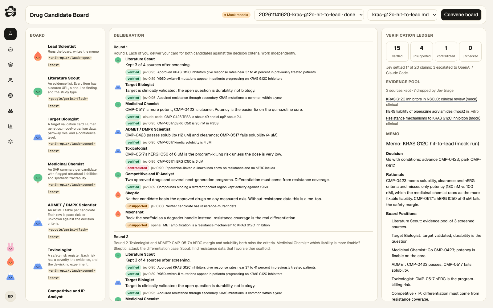

# Drug Candidate Board

A lead scientist and a board of research agents decide whether drug candidates should advance. Each board member has one task and one deliverable. Checkers verify every claim. The output is a go / no-go memo.

The pattern follows IndyDevDan's "CEO and board" video (brief in, memo out, constrained debate, specialized agents, persistent expertise). Here the CEO is a **Lead Scientist**, and the board is research staff working through the literature.



The Board view shows a plain summary (progress, recommendation, how many claims checked out, open questions, next steps). Tick **Show details** for the full roster, discussion with per-claim verdicts, evidence pool and memo ([screenshot](board-details.png)).

> **Skeleton.** It runs end to end today on scripted mock models (no keys). Add keys to `.env` to make it live.

```
brief.md ──▶ Lead Scientist ──converse──▶ 8 board members (parallel, each its own durable conversation)
                 ▲                            │ Literature Scout searches Exa; Jev screens results
                 │                            ▼
                 └── replies + verdicts ◀── claim checks: Jev first ─(uncertain)─▶ OpenAI / Claude Code
             ──write_memo──▶ memo.md + verification_ledger.json
```

## Quick start

```bash
npm run setup           # installs engine + dashboard
npm run board           # one run in the terminal (mock models without keys)
npm run engine          # backend for the dashboard, port 8787; resumes unfinished runs
npm run dashboard       # http://localhost:5317 → "Board" (first icon)
npm run desktop         # same UI as a Tauri desktop app (needs Rust)
```

In VS Code, run **Tasks: Run Task → Board: start all** to start the engine and dashboard together.

## Keys

The only required key is **`OPENROUTER_API_KEY`**. It routes every board model *and* Jev (`typesafe/jev-1.14`), so you don't need a key per model. Copy `.env.example` to `.env`:

| Key | Used for | Required |
|---|---|---|
| `OPENROUTER_API_KEY` | All agents (Opus lead, Sonnet / Gemini Flash / GPT-mini members) + Jev | yes |
| `EXA_API_KEY` | Literature search | for real searches |
| `OPENAI_API_KEY` | Escalation checker for contested literature claims | optional |
| `TYPESAFE_API_KEY` | Jev directly instead of through OpenRouter | optional |

Claude Code (the computed-claim checker) uses your existing `claude` login.

## The board (`board/agents/*.md`)

| Member | Task | Deliverable | Model tier |
|---|---|---|---|
| Lead Scientist | Frames the decision, runs rounds, pushes on disagreement | Memo | lead (Opus) |
| Literature Scout | Exa searches per key question | Screened evidence list | cheap |
| Target Biologist | Is the target worth drugging? | Target validation card | strong |
| Medicinal Chemist | SAR, liabilities, tractability | SAR summary | strong |
| ADMET / DMPK | Each candidate vs. the criteria | Pass / risk / unknown table | cheap |
| Toxicologist | hERG, reactive metabolites, off-targets | Safety risk register | strong |
| Competitive / IP | Competing programs, stage, FTO concerns | Landscape map | cheap |
| Skeptic | The strongest case to kill each candidate | Kill list | rival (second vendor) |
| Moonshot | One alternative bet (modality, repurposing) | One argued idea | strong |

To add or bench a member, add or remove a line under `board:` in `board/config.yaml` and add an agent file. Tiers map to OpenRouter model IDs in `models:`, so changing a model is a one-line edit.

## How it stays cheap

1. **Jev before LLMs.** Every Exa result is triaged by Jev (relevant? reports results? study type?) before any agent reads it.
2. **Jev checks claims.** Members end each reply with a `CLAIMS` section. Jev judges each claim against its cited evidence (`supports` / `contradicts` Nouls, one request per evidence source). Code holds the truth table:
   contradicts > 0.7 → contradicted · supports > 0.7 → verified · both < 0.3 → unsupported · otherwise → **escalate**.
3. **Only the uncertain band escalates**: literature claims go to OpenAI, computed claims to Claude Code (Jev doesn't do math), capped per run.
4. **One budget per run** (`meeting.max_usd`, `max_minutes`, `max_rounds`). Past a limit, the lead is told to wrap up.

All Jev wording lives in `engine/src/questions.ts`. All decision logic lives in `engine/src/jev.ts`.

## Durable over time (Pi Durable)

The engine is built on [`@earendil-works/pi-durable`](https://github.com/earendil-works/pi). Every model turn, tool call and member reply is committed to `board/runs/<run>/session.sqlite` before it's shown. Kill the process at any point (tested with `kill -9` mid-round), then run `npm run resume <run-id>` or restart the engine: the run continues where it stopped. Tools are replay-safe and member inputs carry stable request IDs, so nothing is asked or paid for twice.

## Guarding against multi-agent failure modes

These come from the failure-mode probes in [acyclic-labs/sdk `research/experiments`](https://github.com/acyclic-labs/sdk/tree/main/research/experiments):

| Failure mode | Guard here |
|---|---|
| Sycophancy cascade (claimed consensus moves agents to a wrong answer) | Round 1 is blind: members answer independently (fan-out, not chain). Later digests show arguments with verdicts, never vote tallies. |
| Orchestrator deference | The lead assigns tasks and doesn't reveal its leaning before final positions. The Skeptic runs on a different vendor. |
| Error propagation (one wrong seed spreads) | Evidence is screened before it enters the shared pool. Contradicted claims are marked in every later digest. |
| Budget scaling | One aggregate budget per run, not per agent. Unknown cost is recorded as unknown, not zero. |

## Layout

```
board/                 config.yaml, agents/, briefs/ (+ _template.md), context/ (shared), expertise/, runs/
engine/src/            board.ts (Pi Durable), jev.ts + questions.ts, exa.ts, checkers.ts, claims.ts,
                       models.ts (OpenRouter / mock), mock.ts, server.ts (HTTP + SSE), cli.ts
dashboard/             the hackathon Sim Lab UI (Tauri + React) with a new Board view
```

## Next steps

- [ ] Add keys; run the example brief live; tune Jev questions on real Exa results.
- [ ] Watch mode: scheduled Exa re-queries reopen a run when new evidence changes a verdict (`watch:` in config).
- [ ] Agents write to their `expertise/` files after each run.
- [ ] RDKit tool for the Medicinal Chemist and ADMET members (computed claims from code, not the model).
- [ ] Evals in the acyclic style: plant a wrong claim, fork the session at the same entry, and measure how often the board adopts it.
- [ ] Hosting: Modal for always-on runs and cron watch mode.
- [ ] Add OpenRouter, Exa and TypeSafe keys to the dashboard Settings (keychain) instead of `.env`.

Decision support only. This doesn't replace expert review or regulatory judgment.
