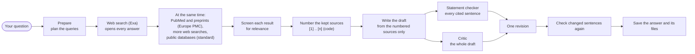

# The research answer

You type a question on the Search screen. The engine searches, writes a short answer from what it found, has
the answer reviewed, and shows you the answer with its numbered sources. This page says what happens, what it
costs, and what the marks mean.

> **Status.** Built and tested with fake models and a fake network (`engine/test/research-*.test.ts`). No real
> model has written an answer yet. Until the first real question has been asked, a real answer is switched off:
> in Real mode `POST /api/research` answers 503 unless the engine was started with `RESEARCH_PREVIEW=1`. Demo
> mode works without it.

The two levels on this page are `quick` and `standard`. The third level, `deep`, is the team review
([drug-board.md](drug-board.md)): it gives you a plan that you confirm. This page does not change it.

## The flow

| Step | Who does it | What it does |
|---|---|---|
| Prepare | cheap model (`models.cheap`) | Writes 1 to 3 web queries, 1 to 3 literature queries and one opening sentence. If its reply cannot be read, the question's own words are searched. |
| Web search | Exa (paid) | Always the first search. `quick`: exactly 1. `standard`: up to 3. |
| Literature search | Europe PMC (free) | PubMed abstracts and preprints. Runs after the first web search, at the same time as the other searches. |
| Database lookups | public databases (free) | `standard` only, up to 2: ClinicalTrials.gov, ChEMBL, openFDA, Open Targets, UniProt, PubChem (`engine/src/sources/`). |
| Screen | cheap model | The board's own first pass (`engine/src/triage.ts`): is the result about the question, does it report findings, what kind of study is it. |
| Number | code | Kept sources become `[1]..[n]`, the most relevant first. The order comes from the plan, not from which reply arrived first. |
| Write | strong model (`models.strong`) | A short answer in Markdown from the numbered sources only. The direct answer comes first. Each finding carries a marker such as `[2]`. |
| Statement checker | cheap model of **another vendor** than the writer | Every cited sentence is checked against every source it cites. The checker must quote a passage. Code then looks for that passage, and for the sentence's numbers, in the source text. |
| Critic | `models.rival`, **another vendor** than the writer | Reads the whole draft with the sources. It looks for what the sentence check cannot see: a conclusion stronger than its sources, a missing caveat, a preprint or a review used as if it were a primary result, sources that disagree, a part of the question that was skipped. Its instructions start with the board critic's own (`board/agents/critic.md`). |
| Revise | strong model | One revision. It must remove or soften what failed. Every cited sentence it changed or added is checked again. |
| Save | code | The record, the event log, and three files: `answer.md`, `sources.json`, `sources.csv`. |

The prompts are plain files you can read and edit: `engine/src/research/prompts/`.

## What code decides, never a model

- Which sources exist and their numbers.
- Which markers stand. A marker that names no kept source is removed. Links and web addresses that are not a
  source's own are removed.
- What the cited sentences are, and the mark of each one (`route` in `engine/src/triage.ts`).
- That a sentence which failed its check is not shown as holding up after the revision. If the revision keeps a
  failed sentence and drops its marker, code puts the marker back and the sentence stays marked as failed.
- What was searched. The writer is given a list written by code. A search that did not run is listed as "did not run".
- The **What is missing** part (see below), the recommendations that are kept, the limits and the cost.

Text from a source is data. It reaches a model only inside the board's escaped evidence block
(`evidenceBlock` in `engine/src/board.ts`). The instructions a model gets are the same whatever a source says
(tested with a hostile source).

## The marks, and what they do not prove

| Mark (`verdict`) | Meaning here |
|---|---|
| `verified` ("Supported") | A model from another vendor than the writer said a cited source states the sentence and quoted the passage. Code found that passage in the source text, and found every number of the sentence in it. |
| `contradicted` | The checker quoted a real passage of a cited source that says otherwise. |
| `unsupported` ("Insufficient evidence") | No cited source was found to state it. This includes a quote that is not in the source, and a quote without the sentence's number. |
| `unchecked` ("Not checked") | The check did not run or its reply could not be read. The reason is given. |

What `verified` does **not** prove:

- It does not prove the sentence is true. It shows that a real passage of the cited source matches it.
- A quote that exists does not prove that the passage supports the sentence. A web page can hold text written to be quoted.
- Only abstracts and short excerpts are read, never the full paper. A number that is only in the full text cannot be checked.
- A sentence that cites two sources is `verified` when one of them states it.
- A sentence with no marker is not checked at all. The writer is told to use such a sentence only for plain
  background or to say what was not found. The critic looks for breaches of that rule; code cannot.

## It may say that something is missing

The system does not have to be right about everything, and an answer does not have to look complete.
"Not found", "not enough evidence" and "the sources disagree" are complete answers. The writer and the critic
are told so in their instructions.

Every answer also gets a **What is missing** list that code builds, so it is there even when the writer
forgets. It holds: each search that did not run or found nothing, each step that failed, each cited sentence of
the final text that did not pass its check, each blocking or major concern of the critic that was left open,
and an early end. It is the `missing` field of the record, the `missing` event, and a section of `answer.md`.

## Levels and limits

Set in `board/config.yaml` under `research:`. Hard bounds hold whatever the file says (`limitsOf` in
`engine/src/research/types.ts`).

| | `quick` | `standard` |
|---|---|---|
| Cost limit for one answer (`max_usd`) | $0.15 | $0.60 |
| Web searches (Exa) | exactly 1 | up to 3 |
| Literature queries | up to 2 | up to 3 |
| Database lookups | 0 | up to 2 |
| Numbered sources | up to 6 | up to 12 |
| Writer's output tokens (draft, and again for the revision) | 2,000 | 3,000 |
| Length asked for | 220 words | 380 words |
| Time limit (`time_limit_seconds`) | 120 s | 120 s |

Other limits: the question is at most 2,000 characters; at most 3 answers are written at once; one browser
origin may ask 6 questions a minute; 3 follow-ups may wait in one thread.

### Money

- **Before every paid step** code checks three things: paid calls are still on, the time limit is not passed,
  and what was spent plus the step's worst case fits under the answer's limit. A step that does not pass is not
  started. The answer then ends with what it has and says so (`stopped` and `note` in the record).
- Every dollar counts against the board's daily limit (`meeting.daily_usd`). The board and the answers share one
  total (`spentToday` in `engine/src/board.ts`). An answer in progress counts for its whole limit.
- Every Exa search goes through the Exa ledger and its lifetime ceiling (`engine/src/exaledger.ts`). When Exa
  cannot be used (no key, the ceiling, a service error) the answer does not fail: the step is shown as failed
  with the reason, and the free searches still run.
- A vendor that refuses a key or a model name ends the answer at once with a plain message.
- Switching to Demo while an answer is being written stops every further paid step.
- No key appears in an event, a record or an error message (`scrub` in `engine/src/research/text.ts`).

### What one answer costs (estimate, not measured)

From the prices in `board/config.yaml` (per million tokens, input / output: Claude Sonnet 5.5 $2 / $10,
Claude Haiku 5.5 $0.10 / $0.50, GPT-4o mini $0.15 / $0.60, GPT-5 mini $0.25 / $2; one Exa search $0.007, assumed).
"Expected" uses abstracts of normal length and answers of the asked length. "Worst case" uses every source at
its 3,000-character cut, every output at its token limit, and 3 characters a token.

| Step | quick, expected | quick, worst case | standard, expected | standard, worst case |
|---|---|---|---|---|
| Prepare (Haiku) | $0.0002 | $0.0006 | $0.0002 | $0.0006 |
| Web search (Exa) | $0.0070 (1) | $0.0070 (1) | $0.0070 (1) | $0.0210 (3) |
| Screening (Haiku) | $0.0014 | $0.0028 | $0.0019 | $0.0074 |
| Draft (Sonnet) | $0.0164 | $0.0388 | $0.0251 | $0.0620 |
| Statement checks (GPT-4o mini) | $0.0014 | $0.0069 | $0.0021 | $0.0138 |
| Critic (GPT-5 mini) | $0.0034 | $0.0073 | $0.0041 | $0.0089 |
| Revision (Sonnet) | $0.0205 | $0.0436 | $0.0292 | $0.0668 |
| Re-check | $0.0003 | $0.0069 | $0.0003 | $0.0138 |
| **Total** | **about $0.05** | **$0.11** | **about $0.07** | **$0.19** |

So both levels fit their limits with the review and the revision included. The `standard` limit of $0.60 is
about three times its worst case; it could be lowered to $0.30. Not verified: the real token counts, the hidden
reasoning tokens of the writer and the critic (they bill as output and are inside the output limits used above),
and the price of one Exa search.

## Follow-up questions

A question sent with `thread` gets the earlier questions of that thread and the first paragraph of each
earlier answer. They are used to plan the searches and to understand what the question refers to. It searches
again. It may list a source of the answer before it again: that source is screened for the new question and
gets a new number in the new list. An old number is never valid in a new answer.

A follow-up sent while its thread is still being answered is **queued**. The engine does not steer a running
answer. The queued question starts when the one before it ends, for any reason. It can be cancelled while it waits.

## Cancel

`POST /api/research/:id/cancel` stops the answer before its next paid step and drops model calls in flight.
Running steps are marked cancelled. What was found by then stays in the record. Cancelling twice, or after the
end, changes nothing.

## Durable

Each answer is a task of the durable harness (Pi Durable), as a team review is. It has its own session file,
`session.sqlite`, in its folder. The result of every paid or outside step (the plan, each search, each
screening, the draft, each statement check, the critic, the revision) is stored in that session under a stable
key before the next step uses it. The key is the answer's id, the step, and a hash of what the step was given.
When the engine stops or crashes, nothing is lost: at the next start the engine continues every unfinished
answer and every queued question. The work runs again from the top, and each stored step is read from the store
instead of being done again. So an answer continues where it stopped, and a finished step is never paid twice.
The event log goes on with the next `seq`, with no repeated event, and holds one `research.resumed` event.
Limits of this: a call that was in flight when the engine died has no stored result and is made again (one
call); time while the engine was down does not count against the time limit; a real answer is not continued
while paid calls are off.

## Demo mode

While paid calls are off, the same endpoint returns a **demo answer**: the same steps and the same event
shapes, with fixed example text, the board's example sources, and scripted checks. It reaches no network and
costs nothing. Everything in it says that it is a demo. It is not research.

## The API

| Request | Answer |
|---|---|
| `POST /api/research {question, effort: "quick" or "standard", thread?}` | `202 {id, thread, mode}`. `202 {..., queued: true, after}` when the thread is busy. In Real mode it needs the session token, like `POST /api/chat`. |
| `POST /api/research/:id/cancel` | `200 {id, status, cancelled, message}` |
| `GET /api/research/:id/events` | The event stream: everything so far, then live. `Last-Event-ID` or `?after=<seq>` continues after a known event. |
| `GET /api/research/:id` | The whole record. |
| `GET /api/research?thread=<id>` | The thread's answers, oldest first. Without `thread`: the newest 50. |
| `GET /api/research/threads` | One line per thread, newest first. |
| `GET /api/research/:id/artifacts` and `.../artifacts/:name` | The registered result files; one of them as a download. |
| `GET /api/search?q=` | Saved answers are found here as `kind: "answer"`, next to the runs. |

Every event has `seq` (1, 2, 3, ... in one answer), `at`, `run` and `type`. The types, in the order they
usually come: `research.queued`, `research.started`, `step.started` / `step.progress` / `step.finished` (kinds:
prepare, search, evaluate, write, check, review, revise, save; status: completed, empty, failed, cancelled),
`opening`, `sources`, `selection`, `answer.delta`, `answer.written`, `review.started`, `statement.checked`,
`review.note`, `answer.revised`, `sources.cited`, `recommendations`, `missing`, `artifact.created`, and one of
`research.finished`, `research.failed`, `research.cancelled`. The exact shapes are in
`engine/src/research/types.ts`. Example streams made by the code are in `engine/test/fixtures/research/`.

## Where an answer is stored

`board/runs/.research/<id>/` (the runs folder can be moved with `DRUG_BOARD_RUNS_DIR`): `record.json`,
`events.jsonl`, `session.sqlite`, and for a finished answer `answer.md`, `sources.json`, `sources.csv` and
`artifacts.json`. Threads have no file of their own: each record names its thread.

## Limits

- Abstracts and excerpts only. No full paper is read.
- No real model has written an answer yet. The model ids, the reply formats and the cost are not verified.
- The marks say what a checker found in a source. They are not a proof (see above).
- Recommendations are kept only when they rest on a kept source that a checked sentence cites. The text of a
  recommendation is written by a model.
- Whether a critic's general note was "addressed" is what the writer reports. Code checks only notes that point
  at a sentence (was it removed or rewritten).
- The time limit is 120 seconds of work. A slow vendor can end an answer early; the answer then says so.
- This is a research summary. It is not medical advice.
