# The research answer

You type a question on the Search screen. The engine searches, writes a short answer from what it found, has
the answer reviewed, and shows you the answer with its numbered sources. This page says what happens, what it
costs, and what the marks mean.

> **Status.** Built and tested with fake models and a fake network (`engine/test/research-*.test.ts`). One real
> answer has been written so far (a `quick` one: 30.9 seconds, $0.074, 14 cited sentences). That is one run, not a
> measurement of quality. A real answer needs the engine to be started with `RESEARCH_PREVIEW=1`; without it, in
> Real mode, `POST /api/research` answers 503. Demo mode works without it.

The two levels on this page are `quick` and `standard`. The third level, `deep`, is the team review
([drug-board.md](drug-board.md)): it gives you a plan that you confirm. This page does not change it.

## The flow

```mermaid
flowchart LR
    q(["Your question"]) --> prepare["Prepare<br/>plan the queries"]
    prepare --> exa["Web search (Exa)<br/>opens every answer"]
    exa --> more["At the same time:<br/>PubMed and preprints (Europe PMC),<br/>more web searches,<br/>public databases (standard)"]
    more --> screen["Screen each result<br/>for relevance"]
    screen --> number["Number the kept sources<br/>[1] .. [n] (code)"]
    number --> write["Write the draft<br/>from the numbered sources only"]
    write --> check["Statement checker<br/>every cited sentence"]
    write --> critic["Critic<br/>the whole draft"]
    check --> revise["One revision"]
    critic --> revise
    revise --> recheck["Check changed sentences again"]
    revise --> second["Critic reads the revision:<br/>is each note resolved?"]
    recheck --> save["Save the answer and its files"]
    second --> save
```

| Step | Who does it | What it does |
|---|---|---|
| Prepare | cheap model (`models.cheap`) | Writes 1 to 3 web queries, 1 to 3 literature queries and one opening sentence. If its reply cannot be read, the question's own words are searched. |
| Web search | Exa (paid) | Always the first search. `quick`: exactly 1. `standard`: up to 3. |
| Literature search | Europe PMC (free) | PubMed abstracts and preprints. Runs after the first web search, at the same time as the other searches. |
| Database lookups | public databases (free) | `standard` only, up to 2: ClinicalTrials.gov, ChEMBL, openFDA, Open Targets, UniProt, PubChem (`engine/src/sources/`). |
| Screen | cheap model | The board's own first pass (`engine/src/board/triage.ts`): is the result about the question, does it report findings, what kind of study is it. |
| Number | code | Kept sources become `[1]..[n]`, the most relevant first. The order comes from the plan, not from which reply arrived first. |
| Write | strong model (`models.strong`) | A short answer in Markdown from the numbered sources only. The direct answer comes first. Each finding carries a marker such as `[2]`. |
| Statement checker | cheap model of **another vendor** than the writer | Every cited sentence is checked against every source it cites. The checker must quote a passage. Code then looks for that passage, and for the sentence's numbers, in the source text. |
| Critic | `models.rival`, **another vendor** than the writer | Reads the whole draft with the sources. It looks for what the sentence check cannot see: a conclusion stronger than its sources, a missing caveat, a preprint or a review used as if it were a primary result, sources that disagree, a part of the question that was skipped. Its instructions start with the board critic's own (`board/agents/critic.md`). |
| Revise | strong model | One revision. It must remove or soften what failed. Every cited sentence it changed or added is checked again. |
| Second look | the critic again | It reads the revised text and says for each of its notes: resolved, partly, or open. Only "resolved" counts as resolved. When it cannot be asked, the record says what code can see (the sentence is gone or changed) and what the writer itself reported, and says which of the two it is. |
| Save | code | The record, the event log, and three files: `answer.md`, `sources.json`, `sources.csv`. |

The prompts are plain files you can read and edit: `engine/src/research/prompts/`.

## What code decides, never a model

- Which sources exist and their numbers.
- Which markers stand. A marker that names no kept source is removed. Links and web addresses that are not a
  source's own are removed.
- What the cited sentences are, and the mark of each one (`route` in `engine/src/board/triage.ts`).
- That a sentence about what is absent is not a sourced claim. Markers inside the "Not found in these sources:"
  paragraph are removed, so those sentences are the answer's own remarks and are not sent to the quote check.
- That a sentence is in the text once. A sentence the writer wrote twice is shown once. A phrase that two
  neighbouring sentences share is reported in the record's `note`; code does not rewrite a sentence.
- That a sentence which failed its check is not shown as holding up after the revision. If the revision keeps a
  failed sentence and drops its marker, code puts the marker back and the sentence stays marked as failed.
- What was searched. The writer is given a list written by code. A search that did not run is listed as "did not run".
- The **What is missing** part (see below), the recommendations that are kept, the limits and the cost.

Text from a source is data. It reaches a model only inside the board's escaped evidence block
(`evidenceBlock` in `engine/src/board/board.ts`). The instructions a model gets are the same whatever a source says
(tested with a hostile source).

## Hypotheses (Standard level)

At the Standard level the answer can set up **hypotheses** and test each one against the evidence. "Tested"
means **checked against published sources** (papers, trial records, pages). It is not an experiment, and the
answer and the app say so.

1. **Set before any search.** After the prepare step, the planner is asked for 2 to 4 competing hypotheses that
   can be checked. If your message already states several hypotheses or questions, those are used, in your
   words (`origin: "user"`). For each one it writes, before anything is searched: the statement, what a source
   would report if it holds (`supportIf`), and what a source would report if it does not (`contradictIf`). For a
   plain factual question it may answer "no hypotheses needed"; then the answer runs as described above.
2. **Each hypothesis has its own investigator.** The investigators work at the same time. Investigator 1 works
   on H1, investigator 2 on H2, and so on. An investigator does its hypothesis's searches (its web search with
   Exa first, then its literature search with Europe PMC, and a database lookup when it planned one and the
   level has room), the screening of what they find (against the hypothesis itself), and then the draft of its
   own section. It is given only its own hypothesis and the sources its own searches found. Every step in the
   event log names who did it (`agent`: `planner`, `investigator-1`, `writer`, `checker`, `critic`). **No limit is raised for this.** Each hypothesis uses one
   web search and one literature query of the level, so with today's limits (3 and 3) at most 3 are tested. A
   proposal that does not fit is set aside and named under "What is missing". The numbered sources (12) are
   shared: the hypotheses take turns, so each one has its share.
3. **The answer** has one section for each hypothesis, drafted by its investigator: `### H1: ...` with lines
   `**For:**`, `**Against:**` and `**Not found:**`. Code sets each section's heading and removes a marker of a
   source that investigator was not given. A hypothesis whose searches found nothing gets a section written by
   code, and no model is asked. Then the writer adds the first paragraph, which compares the hypotheses from
   the sections. Nobody writes a mark. The **checker and the critic are shared** and run on the other vendor:
   they are given the investigators' sentences and the sources, and nothing else of an investigator's work.
   The one revision is done by the writer.
4. **The mark is given by code** (`markOf` in `engine/src/research/pipeline.ts`), never by a model's say-so. A
   sentence counts for or against a hypothesis only when all three hold:
   - the writer filed it under that hypothesis's `For:` or `Against:` line;
   - it passed the quote check against its source (`verified`);
   - a model of **another vendor** than the writer, asked separately and **not told the side**, says it points
     that way (step `check:stance`, prompt `prompts/stance.md`).

| Checked sentences | Mark |
|---|---|
| at least one for it, none against it | **Supported** (`verified`) |
| at least one against it, none for it | **Contradicted** (`contradicted`) |
| some for it and some against it | **Insufficient evidence** (`unsupported`, with `mixed: true`: "the sources disagree") |
| none | **Insufficient evidence** (`unsupported`) |
| sentences passed the quote check, but which way they point was not judged; or the answer ended early | **Not checked** (`unchecked`) |

The rule for mixed evidence is deliberately plain: code does not weigh one study against another, so evidence
on both sides is shown as "the sources disagree", with the source numbers on each side. One checked sentence
from one abstract is enough for Supported or Contradicted; the note of every mark gives the counts ("2 checked
statements from 2 sources for it; none against it"), so a thin mark can be seen to be thin. A mark says what
these sources report. It does not say the hypothesis is true.

## Method specialists

An answer can add **method specialists**: members of the method library (`glhf/specialists`) whose notes fit the
question. This is how a question starts the agents that match it.

1. **Code chooses, not a model.** After the prepare step the engine compares the words of the question with the
   method notes (`matchSpecialists` in `engine/src/specialists.ts`). The best matches join: at most 1 at the Quick
   level and 2 at the Standard level (`specialists` in `board/config.yaml`). A question that fits none gets none.
   The `specialists` event names who joined and why.
2. **Each one reads the search results.** When the searches (Exa, the literature search, the databases) have given
   the numbered sources, each specialist gets the question, its method notes and those sources, and drafts one
   short section: `### Method view: <its title>`. It has no tools: it cannot search or run code. It may only say
   what the sources state.
3. **The model follows the effort, with a company check.** Quick requests the `cheap` tier and Standard requests
   the `strong` tier (`specialist_tier`). The cheap tier is used only if it is from the same company as the
   writer. Otherwise the specialist uses the writer's model. This keeps the statement checker on a different
   company from both. The tiers are set under `models` in `board/config.yaml`.
4. **Its section is reviewed.** The section becomes part of the draft. The statement checker checks each of its
   cited sentences against the source, and the critic reads it, like the rest of the answer.
5. **It never takes money the answer needs.** A specialist is asked only when its worst-case cost fits under the
   answer's limit together with the worst case of the draft, the critic and the revision. If it does not fit, its
   step ends as "Not asked" and the answer goes on without it. Its reply is stored like every paid step, so a
   restart does not pay for it twice.

In a Demo answer the specialist's text is a fixed example sentence, and nothing is spent.

In the events: `specialists` (name, title, agent, why, methods), and steps named `specialist:<name>` with
`agent: "specialist:<name>"`.

In the events: `hypotheses` (id, text, supportIf, contradictIf, origin; `cut` for what was set aside), a
`hypothesis` tag on each search and screening step, `hypotheses` on each source, `hypothesis` and `side` on each
statement, and one `hypothesis.checked` per hypothesis (the mark, the source numbers for and against, the
statement indexes, the investigator, and `testedBy`). The record holds the same under `hypotheses`.

`testedBy` says what a mark rests on. Today it is always `{kind: "sources"}`: published sources. The field
leaves room for a later `{kind: "swarm", run: "<id>"}`: a hypothesis tested on data by a swarm run. That link is
not built.

## The marks, and what they do not prove

| Mark (`verdict`) | Meaning here |
|---|---|
| `verified` ("Supported") | A model from another vendor than the writer said a cited source states the sentence and quoted the passage. Code found that passage in the source text, and found every number of the sentence in it. |
| `contradicted` | The checker quoted a real passage of a cited source that says otherwise. |
| `unsupported` ("Insufficient evidence") | No cited source was found to state it. This includes a quote that is not in the source, and a quote without the sentence's number. |
| `unchecked` ("Not checked") | The check did not run or its reply could not be read. The reason is given. |

What `verified` does **not** prove:

- It does not prove the sentence is true. It shows that a real passage of the cited source matches it.
- A quote that exists does not prove that the passage supports the sentence. A web page can hold text written to be quoted.
- Only abstracts and short excerpts are read, never the full paper. A number that is only in the full text cannot be checked.
- A sentence that cites two sources is `verified` when one of them states it.
- A sentence about what the sources do not contain is not checked: no passage can be quoted for an absence.
- A sentence with no marker is not checked at all. The writer is told to use such a sentence only for plain
  background or to say what was not found. The critic looks for breaches of that rule; code cannot.

## It may say that something is missing

The system does not have to be right about everything, and an answer does not have to look complete.
"Not found", "not enough evidence" and "the sources disagree" are complete answers. The writer and the critic
are told so in their instructions.

Every answer also gets a **What is missing** list that code builds, so it is there even when the writer
forgets. It holds: each search that did not run or found nothing, each step that failed, each cited sentence of
the final text that did not pass its check, each blocking or major concern of the critic that was left open,
and an early end. It is the `missing` field of the record, the `missing` event, and a section of `answer.md`.

## Levels and limits

Set in `board/config.yaml` under `research:`. Hard bounds hold whatever the file says (`limitsOf` in
`engine/src/research/types.ts`).

| | `quick` | `standard` |
|---|---|---|
| Cost limit for one answer (`max_usd`) | $0.15 | $0.60 |
| Web searches (Exa) | exactly 1 | up to 3 |
| Literature queries | up to 2 | up to 3 |
| Database lookups | 0 | up to 2 |
| Numbered sources | up to 6 | up to 12 |
| Hypotheses tested (`hypotheses`) | none | up to 3 (each uses one web search and one literature query) |
| Writer's output tokens (draft, and again for the revision) | 2,000 | 3,000 |
| Length asked for | 220 words | 380 words |
| Time limit (`time_limit_seconds`) | 120 s | 120 s |

Other limits: the question is at most 2,000 characters; at most 3 answers are written at once; one browser
origin may ask 6 questions a minute; 3 follow-ups may wait in one thread.

### Money

- **Before every paid step** code checks three things: paid calls are still on, the time limit is not passed,
  and what was spent plus the step's worst case fits under the answer's limit. A step that does not pass is not
  started. The answer then ends with what it has and says so (`stopped` and `note` in the record).
- Every dollar counts against the board's daily limit (`meeting.daily_usd`). The board and the answers share one
  total (`spentToday` in `engine/src/board/board.ts`). An answer in progress counts for its whole limit.
- Every Exa search goes through the Exa ledger and its lifetime ceiling (`engine/src/paid/exaledger.ts`). When Exa
  cannot be used (no key, the ceiling, a service error) the answer does not fail: the step is shown as failed
  with the reason, and the free searches still run.
- A vendor that refuses a key or a model name ends the answer at once with a plain message.
- Switching to Demo while an answer is being written stops every further paid step.
- No key appears in an event, a record or an error message (`scrub` in `engine/src/research/text.ts`).

### What one answer costs (estimate, not measured)

From the prices in `board/config.yaml` (per million tokens, input / output: Claude Sonnet 5.5 $2 / $10,
Claude Haiku 5.5 $0.10 / $0.50, GPT-4o mini $0.15 / $0.60, GPT-5 mini $0.25 / $2; one Exa search $0.007, assumed).
"Expected" uses abstracts of normal length and answers of the asked length. "Worst case" uses every source at
its 3,000-character cut, every output at its token limit, and 3 characters a token.

| Step | quick, expected | quick, worst case | standard, expected | standard, worst case |
|---|---|---|---|---|
| Prepare (Haiku) | $0.0002 | $0.0006 | $0.0002 | $0.0006 |
| Web search (Exa) | $0.0070 (1) | $0.0070 (1) | $0.0070 (1) | $0.0210 (3) |
| Screening (Haiku) | $0.0014 | $0.0028 | $0.0019 | $0.0074 |
| Draft (Sonnet) | $0.0164 | $0.0388 | $0.0251 | $0.0620 |
| Statement checks (GPT-4o mini) | $0.0014 | $0.0069 | $0.0021 | $0.0138 |
| Critic (GPT-5 mini) | $0.0034 | $0.0073 | $0.0041 | $0.0089 |
| Revision (Sonnet) | $0.0205 | $0.0436 | $0.0292 | $0.0668 |
| Re-check | $0.0003 | $0.0069 | $0.0003 | $0.0138 |
| Critic's second look (GPT-5 mini) | $0.0015 | $0.0040 | $0.0015 | $0.0040 |
| Hypotheses set up (Haiku) and stance check (GPT-4o mini), Standard only | | | $0.0008 | $0.0034 |
| **Total** | **about $0.05** | **$0.12** | **about $0.07** | **$0.21** |

A Standard answer that tests **3 hypotheses** uses all three web searches ($0.021), three investigators that
each draft a section ($0.044 together) and one comparison ($0.011), then the shared review and the revision
($0.035): expected **about $0.12**, worst case $0.29, limit $0.60. The investigators cost about $0.02 more than
one writer would, because each one reads the writing rules again.

So both levels fit their limits with the review, the revision and the second look included. Measured once:
the first real `quick` answer cost $0.074 and took 30.9 seconds (before the second look was added). That is
above the expected figure and under the worst case; one run is not enough to correct the estimate. Not
verified: the token counts over many answers, the hidden reasoning tokens of the writer and the critic (they
bill as output and are inside the output limits used above), and the price of one Exa search.

## Follow-up questions

A question sent with `thread` gets the earlier questions of that thread and the first paragraph of each
earlier answer. They are used to plan the searches and to understand what the question refers to. It searches
again. It may list a source of the answer before it again: that source is screened for the new question and
gets a new number in the new list. An old number is never valid in a new answer.

A follow-up sent while its thread is still being answered is **queued**. The engine does not steer a running
answer. The queued question starts when the one before it ends, for any reason. It can be cancelled while it waits.

## Cancel

`POST /api/research/:id/cancel` stops the answer before its next paid step and drops model calls in flight.
Running steps are marked cancelled. What was found by then stays in the record. Cancelling twice, or after the
end, changes nothing.

## Durable

Each answer is a task of the durable harness (Pi Durable), as a team review is. It has its own session file,
`session.sqlite`, in its folder. The result of every paid or outside step (the plan, each search, each
screening, the draft, each statement check, the critic, the revision) is stored in that session under a stable
key before the next step uses it. The key is the answer's id, the step, and a hash of what the step was given.
When the engine stops or crashes, nothing is lost: at the next start the engine continues every unfinished
answer and every queued question. The work runs again from the top, and each stored step is read from the store
instead of being done again. So an answer continues where it stopped, and a finished step is never paid twice.
The event log goes on with the next `seq`, with no repeated event, and holds one `research.resumed` event.
Limits of this: a call that was in flight when the engine died has no stored result and is made again (one
call, and the vendor may bill both); an Exa search in flight at that moment stays in the Exa ledger at the assumed
price, so the ledger never counts too little; time while the engine was down does not count against the time
limit, and time worked before it does; a cancel made while the engine was down holds at the next start; a real
answer is not continued while paid calls are off (it waits, as a team review does). One process works on one
answer: each answer folder has a lock.

## Demo mode

While paid calls are off, the same endpoint returns a **demo answer**: the same steps and the same event
shapes, with fixed example text, the board's example sources, and scripted checks. It reaches no network and
costs nothing. Everything in it says that it is a demo. It is not research.

## The API

| Request | Answer |
|---|---|
| `POST /api/research {question, effort: "quick" or "standard", thread?}` | `202 {id, thread, mode}`. `202 {..., queued: true, after}` when the thread is busy. In Real mode it needs the session token, like `POST /api/chat`. |
| `POST /api/research/:id/cancel` | `200 {id, status, cancelled, message}` |
| `GET /api/research/:id/events` | The event stream: everything so far, then live. `Last-Event-ID` or `?after=<seq>` continues after a known event. |
| `GET /api/research/:id` | The whole record. |
| `GET /api/research?thread=<id>` | The thread's answers, oldest first. Without `thread`: the newest 50. |
| `GET /api/research/threads` | One line per thread, newest first. |
| `GET /api/research/:id/artifacts` and `.../artifacts/:name` | The registered result files; one of them as a download. |
| `GET /api/search?q=` | Saved answers are found here as `kind: "answer"`, next to the runs. |

Every event has `seq` (1, 2, 3, ... in one answer), `at`, `run` and `type`. The types, in the order they
usually come: `research.queued`, `research.started`, `step.started` / `step.progress` / `step.finished` (kinds:
prepare, hypothesize, search, evaluate, write, check, review, revise, save; status: completed, empty, failed, cancelled),
`opening`, `hypotheses`, `sources`, `selection`, `answer.delta`, `answer.written`, `review.started`,
`statement.checked`, `hypothesis.checked`,
`review.note`, `answer.revised`, `review.resolved`, `sources.cited`, `recommendations`, `missing`,
`artifact.created`, and one of
`research.finished`, `research.failed`, `research.cancelled`. The exact shapes are in
`engine/src/research/types.ts`. Example streams made by the code are in `engine/test/fixtures/research/`.

## Where an answer is stored

`board/runs/.research/<id>/` (the runs folder can be moved with `DRUG_BOARD_RUNS_DIR`): `record.json`,
`events.jsonl`, `session.sqlite`, and for a finished answer `answer.md`, `sources.json`, `sources.csv` and
`artifacts.json`. Threads have no file of their own: each record names its thread.

## Limits

- Abstracts and excerpts only. No full paper is read.
- One real answer has been written. That shows the model ids and the reply formats work; it says little about
  how often an answer is good.
- The marks say what a checker found in a source. They are not a proof (see above).
- Recommendations are kept only when they rest on a kept source that a checked sentence cites. The text of a
  recommendation is written by a model.
- Whether a note of the critic is resolved is the critic's own judgement of the revised text (`by: "reviewer"`).
  It is a model's judgement, not a proof. When the critic could not be asked, the record shows `by: "code"`
  (the sentence is gone or changed) or `by: "writer"` (only the writer's own report).
- A repeated phrase is reported, not fixed: there is one revision, and code does not rewrite prose.
- The time limit is 120 seconds of work. A slow vendor can end an answer early; the answer then says so.
- A hypothesis is tested against published sources only. Nothing is run, measured or simulated. Whether a
  checked sentence points for or against a hypothesis is the agreement of two models; it is not a proof.
- This is a research summary. It is not medical advice.
