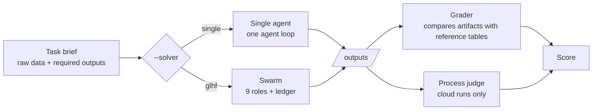
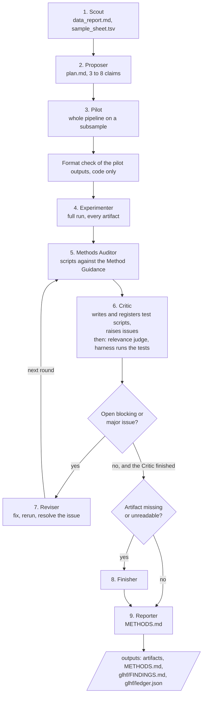
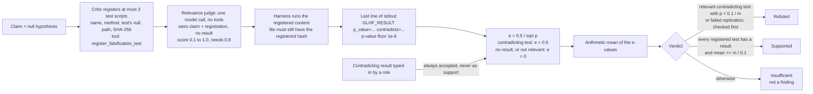

# GLHF swarm: design

This page describes the swarm as the code runs it. Words such as role, phase, claim and ledger
are defined in the [README](../../docs/developers.md#words-used-in-these-documents).

Status: the swarm has run with a real model on the demo case only. No BixBench3 task has been
run. See [docs/status.md](../../docs/status.md).

## 1. Where the swarm sits in BixBench3

Only the solver changes. The sandbox, the time limit, the grader and the judge are the
benchmark's own code, so both solvers are scored in the same way.



Local runs (`glhf_local.py`) use the grader only. The process judge is part of the cloud runner.

The two solvers do not have the same tools. The swarm also has `check_outputs`, the ledger
tools and, when switched on, `search_docs` and approved lessons (memory). See
[docs/reading-results.md](../../docs/reading-results.md#is-the-comparison-fair).

## 2. Phases

Code controls the run (`swarm/solver.py`). There is no supervisor model. The order of phases,
the budgets and the stop rule are fixed.



The diagram shows one review round. The loop runs at most `--review-rounds` times and only
while enough review time is left (see "Time budget").

| # | Role | Phase name in the ledger | Does | Ledger tools | Model group |
|---|---|---|---|---|---|
| 1 | Scout | `scout` | Lists inputs, sample mapping and installed tools. | none | `planner` |
| 2 | Proposer | `propose` | Plans each artifact. Registers 3 to 8 claims. | `propose_claim` | `planner` |
| 3 | Pilot | `pilot` | Runs the whole pipeline on a subsample into `work/glhf/pilot/outputs`. Pilot files never go to `/outputs`. | none | `experimenter` |
| 4 | Experimenter | `experiment` | Runs the full analysis. Writes every artifact. | none | `experimenter` |
| 5 | Methods Auditor | `audit N` | Compares the scripts with the Method Guidance. Writes `adherence.md`. | `raise_issue` | `critic` |
| 6 | Critic | `critique N` | Writes each test of a claim as a script and registers it. Does not run the registered tests and does not report their p-values. Checks outputs and scripts. | `raise_issue`, `register_falsification_test`, `record_falsification_test` (contradicting results only), `report_failed_replication` | `critic` |
| | Relevance judge | `relevance N` | Not one of the nine roles: one model call per review round, after the Critic, with no tools and no sandbox. Rates whether each registered test bears on its claim. Sees the claim and the registration, never a result. Instructions: `swarm/relevance.py`. | none (code records its answer) | `critic` by default (`relevance_model` on the solver) |
| 7 | Reviser | `revise N` | Fixes open issues and reruns later steps. | `resolve_issue` | `experimenter` |
| 8 | Finisher | `finish` | Rescues an artifact that is missing or unreadable. Real data only. | none | `experimenter` |
| 9 | Reporter | `report` | Writes `METHODS.md` from the scripts that ran. With `--memory`, also writes lessons. Code queues them for a person to approve. | none | `reporter` |

Every role also has `bash_session`, `python`, `text_editor`, `request_web_access`,
`check_outputs` and `read_ledger`. The model group is the name used with `--role-model`.

Each role is a separate agent with an empty context. Roles share only the files in the sandbox
and the ledger. The Critic reads files and scripts. It never reads the Experimenter's reasoning.

### Time budget

The swarm uses 97% of the run's time limit. This is "the run" in the table.

| Phase | Share |
|---|---|
| Scout | 3% of the run |
| Proposer | 4% of the run |
| Pilot | 8% of the run |
| Experimenter | 45% of the run |
| Methods Auditor | 10% of the review time left, each round |
| Critic | 30% of the review time left, each round |
| Relevance judge | 5% of the review time left after the Critic, each round; at most 2% of the token budget; floor 20 seconds and about 10,000 tokens |
| Registered tests (run by code, no tokens) | Up to half of the review time then left, shared by the tests waiting; at most 5 minutes a test; a test with less than 10 seconds is not started |
| Reviser | 60% of the review time left (90% in the last round) |
| Finisher | 5% of the run is kept for it. At least 5 minutes on runs of 20 minutes or more. |
| Reporter | 5% of the run is always kept for it. |

Other rules:

- Time that a phase does not use goes to the next phases.
- The relevance judge is part of review. Its floor is protected like any other: the Critic
  may not spend it, in any round. If the plan has no review, it has no judge. If the judge is
  skipped for budget, the ledger records `relevance.skipped`, the tests are not run, and they
  cannot support a claim.
- A phase with less than 10 seconds is skipped.
- A review round starts only if enough review time is left: 15 minutes, or 15% of the run if
  that is less (`min_review_seconds` in `solver.py`). For the default local run of 1,800 seconds
  this is about 4 minutes, so the run gets one review round. Before this rule, such a run got
  no review round. A second round starts only if earlier phases ended early.
- Review time is the time left minus the time kept for the Finisher and the Reporter.
- Default: at most 3 review rounds (`--review-rounds`).

### When review stops

| Case | What happens |
|---|---|
| The Critic finished and no blocking or major issue is open | Review ends. |
| The Critic finished and an issue is open | The Reviser runs. Then the next round starts. |
| The Critic was cut off by a limit and no issue is open | The next round starts, so the Critic can look again. |
| The Critic did not run (no budget) | Review ends. The ledger records `review.incomplete`. |

After the harness runs the registered tests, and before this decision, code raises one `major`
issue for each claim that is now refuted (`flag_refuted` in `ledger.py`; `raised_by` is
`harness`, and `claim_ids` names the claim). The issue is on the claim's artifacts, and its
evidence is the contradicting test or the failed replication. So a refutation starts the
Reviser, who fixes the artifact or closes the issue as `wontfix` with the command and output
that show the artifact is right. It is `major` and not `blocking` because the refuted verdict
has no error bound. The verdict does not change. This is in the phase engine only.

A fix counts as checked again only after a later Critic phase finished. `FINDINGS.md` marks
fixes that were not checked again.

### After review

1. Code checks the format of every required artifact (the "contract check", `check_contract`
   in `swarm/tools.py`).
2. If an artifact is missing, empty, unreadable, has the wrong delimiter or has no row-key
   column, the Finisher runs. Warnings do not start the Finisher. If the check itself cannot
   run, the Finisher is not started.
3. Code stops every background job that a role left running.
4. The Reporter runs. This happens also after an error or a limit.
5. Code writes the final `FINDINGS.md` and `ledger.json`.

### The contract check

The check reads each table the way the benchmark's grader does (`load_table` in
`grading/loaders.py`), so it does not pass a file that the grader would read wrongly.

| Declared format (or file suffix) | Read as |
|---|---|
| `csv`, `csv.gz` | comma-separated |
| `tsv`, `tab`, `txt`, `tsv.gz`, `bed`, `bed.gz` | tab-separated |
| `json` | JSON |
| `table`, `tabular` (not named by the grader's loader) | The delimiter of the header line. A warning is added. |

Files are read as UTF-8 and a byte-order mark at the start is dropped, as the grader does.

| Result | Examples | Starts the Finisher |
|---|---|---|
| Fatal problem | missing file, empty file, cannot be parsed, wrong delimiter, row-key column not in the header | yes |
| Other problem | duplicate or blank row keys, rows with a different number of columns | no; the roles see it and the Critic can raise an issue |
| Warning | one column only, header with no rows, empty JSON, more than half of the sampled cells empty or NA | no |
| Warning (names and formats) | a column that the task's Required Outputs names for the file is not in the header, or differs only in case, spaces, `_`, `.` or `-`; row keys with spaces at the start or end; Ensembl IDs with a version suffix (`.12`), or a mix with and without; numbers written as `1,234`; infinite values | no |

The grader matches column names and row keys as exact strings, so each of these can give an
artifact a score of zero. Code reads the column names from the task text (`required_columns` in
`swarm/tools.py`): the backticked words in the Required Outputs item that names the file (the
whole section when there is one artifact), only in an item that says "column". This reading can
be wrong, so these are warnings only.

A warning can be correct for some tasks, so a role must compare it with the task before it
changes anything.

### Token and message budgets

See [docs/running.md](../../docs/running.md#budgets).

## 2b. The claims engine (`--engine claims`)

**Status: tested with the scripted model only. No real model has run it. The default is still the
phase engine.**

The claims engine treats each claim like a patient. Triage names 3 to 8 claims, each with an
acuity. Each claim is then piloted, worked up and reviewed on its own, in its own folder
(`/workspace/work/glhf/claims/<id>/`), up to `--max-parallel` claims at once (default 2).

| Step | Done by |
|---|---|
| Scout | Code: lists `/data`, checks that each file opens, lists the installed tools (`scout_code`, `swarm/claims_solver.py`). |
| Triage | The planner model: `propose_claim` with an acuity (high, medium, low). |
| Pilot | The experimenter model, mode `pilot`. Code then shape-checks its files. A failure is **dead on arrival**: the claim is rejected at the pilot. |
| Workup | The experimenter model, mode `workup`, on the full data. Code checks that the files exist. |
| Methods Auditor, Critic | Their models, on their own. The critic sees code and files, not the experimenter's notes. A critic works on one claim: it cannot register, record or refute a test on another claim. |
| Tests | The relevance judge, then the harness runs the registered scripts (as in the phase engine). |
| Reviser | The experimenter model, mode `revise N` (N is the review round), on a claim that was sent back. At most 2 review rounds. |
| Finisher | Code: copies each required file to `/outputs` from the best claim that wrote it (supported, then not established, then rejected). A file no claim wrote stays missing. Nothing is made up. |
| Reporter | The reporter model writes `METHODS.md`. |

**The Board** (`swarm/board.py`) holds one record per claim and a state machine:
`triaged -> piloting -> in_workup -> under_review -> supported | rejected | not_established`, and
`under_review -> sent_back -> in_workup`. Code makes every change. An illegal change is refused and
logged. The outcome of a review comes from the ledger's verdict and the open issues on the claim
(`review_outcome`). A model never decides it. A role that crashes, times out or ends without
`claim_done` gets one retry. After that the claim is `not_established`, never `rejected`: a crash
says nothing about the claim.

**Budget** (`swarm/claim_budget.py`). The run keeps one budget, the same as the single agent. The
claims share what is left after the report, finish and overshoot reserves and the triage call:
15% is held back, and the rest is split by acuity (3, 2, 1). Inside a claim: pilot 15%, workup 50%,
review and revise 35%. After each review round, what closed claims did not spend goes to the open
ones (re-triage). New work stops when one more step would reach the reserves.

The review share is split again, by role and by round (`REVIEW_SPLIT`): audit 30%, critique 45%,
revise 25%. With R rounds, a role may have spent n/R of its part by the end of round n. So what a
round does not use rolls forward to the same role, and round 1 cannot empty the review share for
round 2. A retry gets what the first attempt left, not a second share. When one reviewer is off, the
other gets its part. Pilot and workup calls keep their stage share, as before.

Each call's token limit is its cap (`call_tokens`). The tokens a call used are read from its own
token limit, so claims that run at the same time are counted apart. Each call is booked in the run's
`TokenBook` as soon as it ends (`TokenBook.charge`, ledger event `claims.settled`). Tokens over the
cap are borrowed from the overshoot reserve, then the finish reserve, never the report's. So the
book is right between claim calls, and the relevance judge, settled after each critique round, pays
only its own tokens. After the claims, any difference between the book and the run's counter is
logged as `claims.drift`, not hidden.

Each call's time limit (`call_seconds`) is its stage share of the claim's seconds. It is at least
30 s, but never more than the claim has left, so the floor cannot use another claim's time. It is at
most the run's time left minus what the claim's later stages need, while that leaves room for the
30 s. Calls that run at the same time share the wall clock, so each one ends before the reserves.

**Ablations** (`swarm/flags.py`): `--no-auditor`, `--no-pilot`, `--no-retriage`. They do not change
the run's budget. The critic cannot be switched off. It is the role that tests each claim on its
own: it sees only code and files, reruns code and registers at least one falsification test. No
other role registers tests, so without a critic no claim could be supported.

**Files**, next to `ledger.json` in the run folder and in `outputs/glhf/`: `board.json` (after every
change), `events.jsonl` (every change, agent call and budget step), `rejections.json` (claim, stage,
reason, evidence). FINDINGS.md gets the claims table and the rejection log.

Run it locally (scripted, free):

```bash
cd glhf/bixbench
uv run python -m bixbench3.glhf_local --case ../demo_case --out /tmp/claims-run --engine claims --model mock
```

The engine's launcher (`npm run glhf -- run`) does not pass `--engine` yet.

Known limits:
- Two claims on the same artifact each compute it. The Finisher keeps the best one.
- Resume after a crash is not possible: the upstream setup clears `/workspace/work` and `/outputs`.
  The Board is saved after every change, for the record.
- Claims dropped at the pilot still count in the Bonferroni family (the ledger rules are unchanged).

## 3. From claim to verdict

No model decides a verdict, and no model reports a p-value that counts as support.

1. The Critic writes each test as a script and registers it (path, content, SHA-256 hash).
2. A separate model call, the relevance judge, rates whether the test bears on the claim. It
   sees the claim and the registration. It never sees a result.
3. Code (the harness) runs the registered script in the sandbox and reads the p-value from the
   last line of its output.
4. `swarm/ledger.py` computes the verdict.



A claim with no result at all is untested.

`m` is the number of registered claims. `alpha` is 0.1 and is shared by all claims
(Bonferroni correction).

| Constant | Value | Where |
|---|---|---|
| Error level | 0.1 | `ALPHA` in `ledger.py` |
| Calibrator | 0.5, so `e = 0.5 * p^(-0.5)` | `KAPPA` |
| p-value floor | `1e-6`, so one test gives at most `e = 500` | `P_FLOOR` |
| Registered tests per claim | at most 3, one run per test | `MAX_TESTS` |
| Relevance threshold | 0.8 on the rubric 0.1, 0.2, 0.4, 0.6, 0.8, 1.0 | `RELEVANCE_THRESHOLD` |
| Result line | `GLHF_RESULT p_value=<number in [0, 1]> contradicts=<true|false>` | `RESULT_LINE` |
| Largest registered script | 64 KB; the content is kept in the ledger | `MAX_SCRIPT_BYTES` |
| Longest run of one test | 300 seconds | `TEST_SECONDS` in `tools.py` |

Rules (`register_test`, `judge_relevance`, `record_run` and `record_test` in `ledger.py`;
`run_registered_test` in `tools.py`; `relevance.py`):

| Rule | Reason |
|---|---|
| A test is a script file under `/workspace/` (`.py`, `.sh` or `.R`). Its path, content and SHA-256 hash are recorded at registration, before the claim has any result. Registration closes at the first result or the first run, also a failed run. | The tests that count are fixed before their outcomes are recorded. The best few of many cannot be picked afterwards, and a test cannot be reworked after its result is seen. |
| Relevance is judged after registration and before the run, once. The ledger refuses a run without a judgement and a judgement after a run. | The judge cannot be influenced by a result, and a judgement cannot be changed to fit one. |
| A test scored under 0.8, or not scored, is still run and recorded, but counts as `e = 0`. It cannot support and cannot refute. | A test about something else can come out "significant" whatever the claim. This is Assumption 1 of the Popper paper; removing its relevance checker raised the false-support rate there. |
| The harness runs the test, not a model. The file at the registered path must still have the registered hash. The registered content itself is given to the interpreter. | The number comes from the registered file, unchanged. Nobody typed it. |
| The result is the last non-empty line of standard output, in one fixed format. | Code can parse it. A model misreading its own output is the most common failure in the Popper paper (35.9% of failures). |
| A script that changed, is missing, exits with an error, runs too long or prints no result line has no result. It counts as `e = 0` and blocks support, like a registered test that was never run. The command, exit code, runtime and the end of the output are kept in the ledger. | A bad result cannot be turned into "no result" to get it out of the mean. The reason is visible. |
| A result typed in by a role is accepted only when it contradicts the claim. It is always accepted then: registered or not, over the limit of 3 or not. | It can only lower the mean, and it can refute. A typed-in favourable result is refused. |

Why the mean and not the product: the mean of e-values is an e-value under any dependence
between the tests. A product is an e-value only if the tests are independent, and code cannot
check that. The cost: evidence does not multiply, so one strong test is worth more than
several weak tests.

The ledger summary that the roles read states the p-value one test must reach on its own, and
the number of permutations that takes (`p_needed` and `permutations_needed` in `ledger.py`).
With 8 claims the bar is 80, so one test needs p <= 3.9e-05, or at least 25,599 permutations;
10,000 permutations are not enough once there are 6 claims. The Critic's instructions say this.
These are not new rules: they are read from the constants above.

### What the rules give, and what they do not

A claim whose null hypothesis is true is marked supported with probability at most
`alpha / m`, under any dependence between its registered tests, **if** each counted script
computes a valid p-value under a null that follows from the claim's null, and the script was
not chosen or tuned on the data it tests.

| | |
|---|---|
| Code now proves | The p-value was produced by running the registered file. The file did not change after registration. No model typed the number. The relevance judgement was made before the run. |
| Code cannot prove | That the script is a meaningful test. It can print a constant, or compute an invalid p-value. |
| Code cannot prove | That the relevance judgement is right. It is one model reading a description and a script: a filter, not a proof. In the Popper paper the same kind of judge agreed only moderately with human raters (Spearman 0.55). Text written by the Critic reaches the judge. |
| Code cannot prove | That the model did not run the script, or look at the data, before registering it. The sandbox is the model's own workshop. A model that tries 100 scripts and registers the best one gets the same p-value from the harness. |
| Not controlled | The refuted verdict. One mistaken contradicting test can refute a true claim. |
| Recorded, not prevented | The judge and the Proposer on the same vendor (`same_vendor_as_proposer` in the ledger). Same vendor can mean the same blind spots. |

`FINDINGS.md` says this in every run.

### Simulation of false support

`tests/unit/test_glhf_ledger.py` runs true-null claims through the ledger's own entry points.
The table gives the share of runs in which at least one true-null claim was marked supported
(20,000, 6,000 and 3,000 runs for 1, 8 and 20 claims; fixed seeds). "Before" is the rule set
of commit `4084a3a` (a model typed the p-values, no relevance check). The bound is 0.1.

| Critic's behaviour | Before: 1 / 8 / 20 claims | Now: 1 / 8 / 20 claims |
|---|---|---|
| Three independent registered tests per claim | 0.0009 / 0 / 0 | 0.0009 / 0 / 0 |
| One test registered three times | 0.0020 / 0.0003 / 0.0003 | 0.0020 / 0.0003 / 0.0003 |
| 100 tests in private, tries to record the best without registering it | 0.0018 / 0.0002 / 0 | 0.0018 / 0.0002 / 0 |
| Lets only favourable registered tests through | 0 / 0 / 0 | 0 / 0 / 0 |
| Types in `p = 1e-6`, runs nothing | **1.0 / 1.0 / 1.0** | 0 / 0 / 0 |
| Reworks the registered script 100 times, keeps the best | **0.219 / 0.033 / 0.011** | 0 / 0 / 0 |
| Registers a test that rejects whatever the claim (not relevant) | **1.0 / 1.0 / 1.0** | 0 / 0 / 0 if the judge catches it; 0.15 / 0.72 / 0.96 if the judge misses 15% of such tests; 0.51 / 1.0 / 1.0 if it misses half |
| Tries 100 scripts in private **before** registering, registers the best | **0.224 / 0.027 / 0.014** | **0.224 / 0.027 / 0.014** (unchanged: code cannot see this) |

Read the last two rows carefully. The relevance row is exactly as good as the judge: the
miss rates 15% and 50% are assumptions for the simulation, not measurements. The last row is
the limit that remains. In the first four rows the rate is far below 0.1 because the mean
rule is conservative.

No real-model run has used these rules yet. The real-model run on the demo case used the
older product rule, and the scripted demo proves the plumbing only.

The full table of rules is in
[docs/reading-results.md](../../docs/reading-results.md#verdict-rules).

## 4. Guards

| Risk | Guard |
|---|---|
| The Critic is talked into agreement | Each role has an empty context. The Critic reads files, not the Experimenter's reasoning. |
| One model has the same blind spots in every role | `--role-model critic=...` puts the Critic and the Methods Auditor on a second vendor. Not tried in a run yet. |
| A missing artifact scores zero | Pilot first. `check_outputs` for every role. Format check each round. Finisher at the end. |
| Made-up outputs | Roles are told that a missing artifact is better than a placeholder. The Finisher may use real data only. |
| A model reports only good tests | Tests are registered before any result. A registered test with no result counts as `e = 0` and blocks support. A contradicting result is always accepted and counts as `e = 0.5`. A test name is accepted once. Limit: code cannot see a test that was run in private before registration. |
| An artifact in a format the grader reads wrongly | The contract check uses the grader's delimiter rules. A wrong delimiter is a fatal problem. |
| Answer leakage through search | `search_docs` covers a fixed list of 9 documentation sites, with path rules for `bioconductor.org` and a list of named projects for `readthedocs.io`. No forums, no package indexes. Queries with study identifiers are refused after the text is normalised. At most 20 searches per run. Off by default. |
| Answer leakage through memory | A run only queues lessons. A person approves each lesson before any run sees it. Lessons are also filtered in code, are never shown to a run on the same task or on a task in the lesson's context, and are written before grading. past.dev gets only approved lessons. |
| Answer leakage through the network | The benchmark's network policy protects the reference bucket. We have not tested this gate. The local sandbox has no network. |
| Jobs left running by a role that hit its limit | The next role is told about them. Code stops them before the Reporter runs. |

## 5. What a run writes

| File | Content |
|---|---|
| `outputs/<artifacts>` | Graded against the reference tables. |
| `outputs/METHODS.md` | What was run, deviations, failures. |
| `outputs/glhf/FINDINGS.md` | Supported, refuted and not established claims. Fixed and open issues. |
| `outputs/glhf/ledger.json` | Every claim, registered test (with its script, hash, relevance judgement and the harness's run), result, e-value, issue and event. This is the roles' working copy; the copy that counts is `<run folder>/ledger.json`, written by the solver process. |
| `outputs/glhf/scripts/`, `plan.md`, `notebook.md`, `deviations.md`, `sample_sheet.tsv`, `data_report.md`, `pilot_report.md`, `adherence.md` | Working files, copied if they exist. |
| `outputs/glhf/lessons.md` | Only with `--memory`. The lessons of this run that passed the filter. The same lines are queued in `lessons.pending.md` of the memory folder, for a person to approve. |

## 6. Files

```
glhf/bixbench/src/bixbench3/
  glhf_local.py                run one case on this machine and grade it; the scripted model
  cli.py                       cloud runner: --solver, --role-model, --review-rounds
  inspect_harness/
    solvers.py                 upstream single-agent solver (unchanged)
    tasks.py                   solver = single | glhf, task arguments, run metadata
    swarm/solver.py            phases, budgets, stop rule
    swarm/roles.py             instructions for each role
    swarm/ledger.py            claims, e-values, verdicts, FINDINGS.md
    swarm/tools.py             contract check, ledger tools, search_docs and its site list
    swarm/guards.py            text checks for study identifiers (search and memory)
    swarm/memory.py            pending and approved lessons, the filter, the approve command
    swarm/past_memory.py       past.dev client
    swarm/baseline.py          single agent with the 10% token reserve
    swarm/catalog.py           the roles as data for the dashboard
```

## 7. Open questions

- Is the swarm better than the single agent on a real task? Not known.
- Are nine roles better than fewer roles? Not known.
- On the demo case the swarm used about 15 times the tokens for the same score.
- Do the registration rule and the mean work well with a real model? Not known. No real-model
  run has used them.

The older planning document `GLHF-ideas-and-design.docx` in this folder is not kept up to date.
