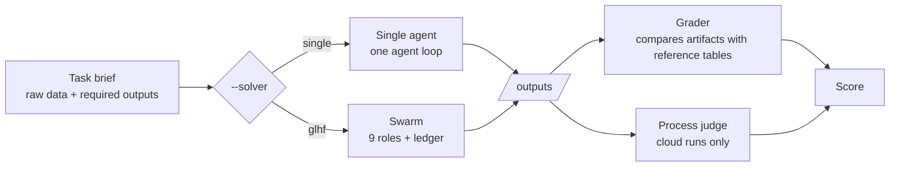
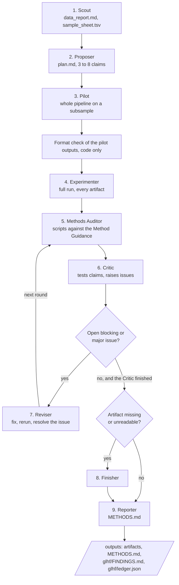
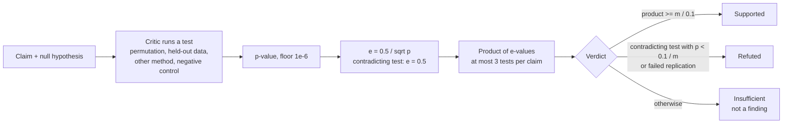

# GLHF swarm: design

This page describes the swarm as the code runs it. Words such as role, phase, claim and ledger
are defined in the [README](../../README.md#words-used-in-these-documents).

Status: the swarm has run with a real model on the demo case only. No BixBench3 task has been
run. See [docs/status.md](../../docs/status.md).

## 1. Where the swarm sits in BixBench3

Only the solver changes. The sandbox, the time limit, the grader and the judge are the
benchmark's own code, so both solvers are scored in the same way.



Local runs (`glhf_local.py`) use the grader only. The process judge is part of the cloud runner.

The two solvers do not have the same tools. The swarm also has `check_outputs`, the ledger
tools and, when switched on, `search_docs` and memory. See
[docs/reading-results.md](../../docs/reading-results.md#is-the-comparison-fair).

## 2. Phases

Code controls the run (`swarm/solver.py`). There is no supervisor model. The order of phases,
the budgets and the stop rule are fixed.



| # | Role | Phase name in the ledger | Does | Ledger tools | Model group |
|---|---|---|---|---|---|
| 1 | Scout | `scout` | Lists inputs, sample mapping and installed tools. | none | `planner` |
| 2 | Proposer | `propose` | Plans each artifact. Registers 3 to 8 claims. | `propose_claim` | `planner` |
| 3 | Pilot | `pilot` | Runs the whole pipeline on a subsample into `work/glhf/pilot/outputs`. Pilot files never go to `/outputs`. | none | `experimenter` |
| 4 | Experimenter | `experiment` | Runs the full analysis. Writes every artifact. | none | `experimenter` |
| 5 | Methods Auditor | `audit N` | Compares the scripts with the Method Guidance. Writes `adherence.md`. | `raise_issue` | `critic` |
| 6 | Critic | `critique N` | Tests each claim. Checks outputs and scripts. | `raise_issue`, `record_falsification_test`, `report_failed_replication` | `critic` |
| 7 | Reviser | `revise N` | Fixes open issues and reruns later steps. | `resolve_issue` | `experimenter` |
| 8 | Finisher | `finish` | Rescues an artifact that is missing or unreadable. Real data only. | none | `experimenter` |
| 9 | Reporter | `report` | Writes `METHODS.md` from the scripts that ran. With `--memory`, also writes lessons. | none | `reporter` |

Every role also has `bash_session`, `python`, `text_editor`, `request_web_access`,
`check_outputs` and `read_ledger`. The model group is the name used with `--role-model`.

Each role is a separate agent with an empty context. Roles share only the files in the sandbox
and the ledger. The Critic reads files and scripts. It never reads the Experimenter's reasoning.

### Time budget

The swarm uses 97% of the run's time limit. This is "the run" in the table.

| Phase | Share |
|---|---|
| Scout | 3% of the run |
| Proposer | 4% of the run |
| Pilot | 8% of the run |
| Experimenter | 45% of the run |
| Methods Auditor | 10% of the review time left, each round |
| Critic | 30% of the review time left, each round |
| Reviser | 60% of the review time left (90% in the last round) |
| Finisher | 5% of the run is kept for it. At least 5 minutes on runs of 20 minutes or more. |
| Reporter | 5% of the run is always kept for it. |

Other rules:

- Time that a phase does not use goes to the next phases.
- A phase with less than 10 seconds is skipped.
- A review round starts only if at least 15 minutes of review time are left. On a short run
  (for example the default 30 minutes of a local run) this can mean that no review round runs.
- Default: at most 3 review rounds (`--review-rounds`).

### When review stops

| Case | What happens |
|---|---|
| The Critic finished and no blocking or major issue is open | Review ends. |
| The Critic finished and an issue is open | The Reviser runs. Then the next round starts. |
| The Critic was cut off by a limit and no issue is open | The next round starts, so the Critic can look again. |
| The Critic did not run (no budget) | Review ends. The ledger records `review.incomplete`. |

A fix counts as checked again only after a later Critic phase finished. `FINDINGS.md` marks
fixes that were not checked again.

### After review

1. Code checks the format of every required artifact.
2. If an artifact is missing, empty, unreadable or without its row-key column, the Finisher
   runs. Warnings do not start the Finisher.
3. Code stops every background job that a role left running.
4. The Reporter runs. This happens also after an error or a limit.
5. Code writes the final `FINDINGS.md` and `ledger.json`.

### Token and message budgets

See [docs/running.md](../../docs/running.md#budgets).

## 3. From claim to verdict

No model decides a verdict. The Critic reports p-values from tests it ran. `swarm/ledger.py`
does the rest.



`m` is the number of registered claims. `alpha` is 0.1 and is shared by all claims
(Bonferroni correction).

| Constant | Value | In `ledger.py` |
|---|---|---|
| Error level | 0.1 | `ALPHA` |
| Calibrator | 0.5, so `e = 0.5 * p^(-0.5)` | `KAPPA` |
| p-value floor | `1e-6`, so one test gives at most `e = 500` | `P_FLOOR` |
| Tests per claim | at most 3, one result per test name | `MAX_TESTS` |

What the rules give: if the tests on a claim are independent, a claim with no real effect is
marked supported with probability at most `alpha / m`. The module text of `ledger.py` gives the
bound for the case that the three tests are copies of one test.
`tests/unit/test_glhf_ledger.py` checks the rules, including a simulation.

What code cannot check: the p-values come from a model, and the independence of tests is an
assumption. `FINDINGS.md` says so in every run.

The full table of rules is in
[docs/reading-results.md](../../docs/reading-results.md#verdict-rules).

## 4. Guards

| Risk | Guard |
|---|---|
| The Critic is talked into agreement | Each role has an empty context. The Critic reads files, not the Experimenter's reasoning. |
| One model has the same blind spots in every role | `--role-model critic=...` puts the Critic and the Methods Auditor on a second vendor. Not tried in a run yet. |
| A missing artifact scores zero | Pilot first. `check_outputs` for every role. Format check each round. Finisher at the end. |
| Made-up outputs | Roles are told that a missing artifact is better than a placeholder. The Finisher may use real data only. |
| A model reports only good tests | Every recorded test counts. A contradicting test counts as `e = 0.5`. A test name is accepted once. |
| Answer leakage through search | `search_docs` covers a fixed list of documentation sites and refuses study identifiers. Off by default. |
| Answer leakage through memory | Lessons are filtered in code, are never shown to a run on the same task, and are written before grading. |
| Answer leakage through the network | The benchmark's network policy protects the reference bucket. We have not tested this gate. The local sandbox has no network. |
| Jobs left running by a role that hit its limit | The next role is told about them. Code stops them before the Reporter runs. |

## 5. What a run writes

| File | Content |
|---|---|
| `outputs/<artifacts>` | Graded against the reference tables. |
| `outputs/METHODS.md` | What was run, deviations, failures. |
| `outputs/glhf/FINDINGS.md` | Supported, refuted and not established claims. Fixed and open issues. |
| `outputs/glhf/ledger.json` | Every claim, test, e-value, issue and event. |
| `outputs/glhf/scripts/`, `plan.md`, `notebook.md`, `deviations.md`, `sample_sheet.tsv`, `data_report.md`, `pilot_report.md`, `adherence.md` | Working files, copied if they exist. |
| `outputs/glhf/lessons.md` | Only with `--memory`. The lessons that passed the filter. |

## 6. Files

```
glhf/bixbench/src/bixbench3/
  glhf_local.py                run one case on this machine and grade it; the scripted model
  cli.py                       cloud runner: --solver, --role-model, --review-rounds
  inspect_harness/
    solvers.py                 upstream single-agent solver (unchanged)
    tasks.py                   solver = single | glhf, task arguments, run metadata
    swarm/solver.py            phases, budgets, stop rule
    swarm/roles.py             instructions for each role
    swarm/ledger.py            claims, e-values, verdicts, FINDINGS.md
    swarm/tools.py             format check, ledger tools, search_docs
    swarm/memory.py            lessons file and the filter
    swarm/past_memory.py       past.dev client
    swarm/baseline.py          single agent with the 10% token reserve
    swarm/catalog.py           the roles as data for the dashboard
```

## 7. Open questions

- Is the swarm better than the single agent on a real task? Not known.
- Are nine roles better than fewer roles? Not known.
- On the demo case the swarm used about 15 times the tokens for the same score.

The older planning document `GLHF-ideas-and-design.docx` in this folder is not kept up to date.
