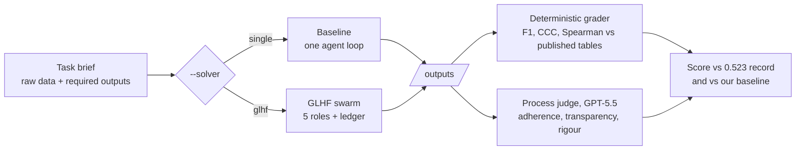
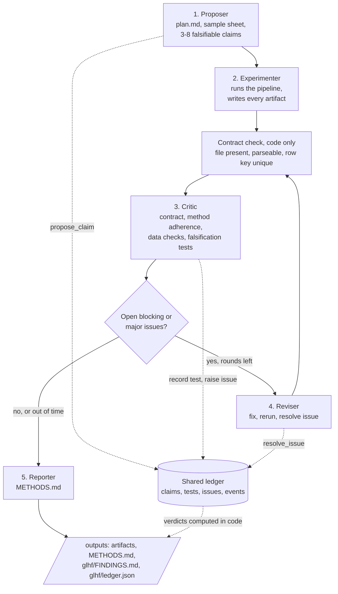
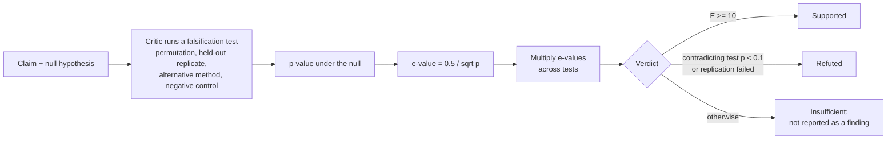

# GLHF design schematic

Track 3, AI Scientist Swarms. Question: can a team of agents reproduce a computational biology
study from raw data better than one frontier model on the same compute budget?

## 1. Where GLHF sits in BixBench3

Only the solver changes. Sandbox, tools, time limit, grader and judge are the benchmark's own, so
the swarm and the single-agent baseline are scored the same way.



## 2. Inside the swarm

Orchestration is code, not a supervisor model. Phases, time budgets and the stop rule are fixed in
`swarm/solver.py`.



| Role | Does | Writes to ledger | Time share |
|---|---|---|---|
| Proposer | Inventories inputs, plans each artifact, registers claims | claims | 5% |
| Experimenter | Runs QC, alignment, counting, statistics | nothing | 50% |
| Critic | Checks outputs and scripts, runs falsification tests | tests, issues | 35% of what is left, per round |
| Reviser | Fixes open issues and reruns downstream steps | issue resolutions | rest of the round |
| Reporter | Writes METHODS.md from the scripts actually run | nothing | 5% reserved |

Up to 3 critique/revise rounds. The loop stops early when no blocking or major issue is open.
Reporting always runs, even after a failure or a time limit.

## 3. How a claim becomes a finding or a rejection

No model decides a verdict. The critic supplies p-values from code it ran; `swarm/ledger.py` does
the rest (Popper-style sequential falsification).



Type-I control: alpha = 0.1. A true-null claim reaches "supported" with probability at most 0.1
(Ville's inequality on the e-value product). `tests/unit/test_glhf_ledger.py` checks this by
simulation.

## 4. Guards

| Risk | Guard |
|---|---|
| Critic is talked into agreeing | Each role has a fresh context. The critic reads files and scripts, never the experimenter's reasoning. |
| Same-model blind spots | `--role-model critic=openai/...` puts the critic on a second vendor. |
| Missing artifact scores 0 | Experimenter produces a first version of every artifact before polishing; contract check runs each round. |
| Fabricated outputs | Roles are told a missing artifact beats a placeholder; the critic checks provenance. |
| Answer leakage | Ground-truth bucket is public. The benchmark's network gateway blocks it; roles may fetch only references and software. |
| Unfair comparison | Same model, VM, time limit and grader for both solvers. Solver and role models are recorded in the run manifest. |

## 5. What gets reported

- `outputs/<artifact files>`: graded against the published tables.
- `outputs/METHODS.md`: what was actually run, deviations, failures.
- `outputs/glhf/FINDINGS.md`: supported findings, rejected claims, claims not established, and
  analyses the critic rejected before reporting.
- `outputs/glhf/ledger.json`: every claim, test, e-value, issue and phase event.

## 6. Files

```
bixbench/src/bixbench3/inspect_harness/
  solvers.py           upstream single-agent baseline (unchanged)
  tasks.py             solver= single | glhf, per-role model args
  swarm/solver.py      phases, budgets, stop rule
  swarm/roles.py       role instructions
  swarm/ledger.py      claims, e-values, verdicts, findings report
  swarm/tools.py       contract check and ledger tools
bixbench/src/bixbench3/cli.py   --solver, --role-model, --review-rounds
```


## Update: nine roles

Four roles were added, each tied to a way the benchmark loses points. Order:
scout, propose, pilot, experiment, then rounds of (audit, critique, revise), finish if needed, report.

- **Scout** (3% of the budget): inventories inputs, sample mapping and installed tools before planning.
- **Pilot** (8%): runs the whole pipeline on a subsample into `work/glhf/pilot/outputs`; code then
  shape-checks those files and hands the result to the Experimenter. Pilot files never go to `/outputs`.
- **Methods Auditor** (10% of each review round): checks scripts against the Method Guidance and
  writes `adherence.md`. It shares the Critic's model setting, so `--role-model critic=...` moves both.
- **Finisher** (5% held back): runs only when the final shape check still fails; real data only.

The Experimenter's share dropped from 50% to 45%. Tested with the scripted model only, including a
test where review is off and the Finisher rescues a broken artifact. Whether nine roles beat five,
or one, on a real task is not known yet.
